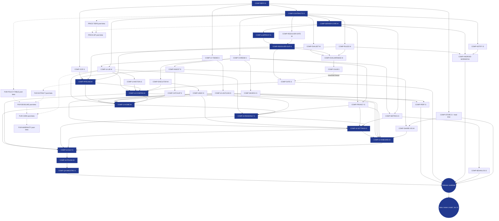

# BUILD_HANDOFF.md: Screenshot Actions beta

Status: FINAL design handoff, 2026-11-19. **Nothing has been built, installed or run.** This document is the only input a sprint-planning agent needs. It deliberately contains **no sprints**: it lists components, sizes, dependencies, gates, checkpoints and cuts. Later-decided rules win over earlier ones (Chair decisions D1–D22 are authoritative). Stable IDs come from the design docs: `F*` features, `SCR-/CMP-/ST-/NTF-/A11Y-/MAE-` UI, `COMP-` components, `AI-` pipeline stages, `ACT-` actions, `SEC-` controls, `EVAL-/QA-` checks, `SP-` spikes. Every number marked *(est.)* is an estimate; links/claims marked **(verify)** must be checked at build time.

---

## 0. If you read nothing else

- **Product:** a phone app that turns a screenshot of a flyer or group-chat plan into a pre-filled calendar item (an event, or a deadline with up to 3 alerts). The user taps [Review], checks highlighted fields and taps Add (2 taps minimum; no one-tap Add from a card or notification in beta, D19/D20); Undo is always available.
- **Iron rule:** *the model reads and proposes; deterministic code validates and executes; the user confirms.* No write without a user tap on a sheet that shows every field.
- **Stack:** Expo (React Native, TypeScript, new architecture) with EAS cloud builds from Windows (no Mac, zero custom Swift); one thin Kotlin WorkManager worker on Android; one Python FastAPI container calling Claude Haiku 5.5; on-device SQLite (core.db + rebuildable FTS5 index.db).
- **Per-platform magic moment:** Android: screenshot → "Ready to add" notification with the app closed (p50 5 s / p95 10 s). iOS: share sheet → "Reading…" card ≤1 s → filled card; plus catch-up of new screenshots on app open.
- **Scope:** 7 beta features (F1, F2+F2f, F3, F4 incl. former F5, F6, F7, F8). 4 screens. 39 components: **25 S, 14 M, 0 L** = ~53 fresh 5-hour sessions *(est.)*, before buffer.
- **Calendar:** today Thu 2026-11-19; beta installable by real testers **Fri 2027-01-15**. ~8 weeks including Thanksgiving (Nov 26) and the Christmas/New Year break. Total work, not the dependency chain, is the binding constraint: ~53 sessions needs ~7 sessions/week. If the weekly cap allows fewer, start applying the cut list (§8) from item 0 at checkpoint CP2.
- **Critical path (20 sessions):** COMP-REPO → COMP-CONTRACTS → COMP-SERVER-CORE → COMP-LLMPROXY → COMP-RESOLVER-GVP → COMP-PIPELINE → COMP-UI-CONFIRM → COMP-UI-HOME → COMP-UI-READONLY → COMP-UI-SETTINGS → COMP-UI-ONBOARD → COMP-UI-A11Y → COMP-UI-POLISH → COMP-QA-MAESTRO → release candidate → Beta App Review (calendar lead time). The **store/TestFlight lead-time track** runs alongside it from day 1.
- **Week-1 musts:** enrol in both stores and push hello-world builds (SP-1); pin the Expo SDK and smoke-test the dependency matrix (SP-13, owned by COMP-REPO); verify provider retention and our DB backup retention (SP-6); run the real-screenshot test (SP-5, owned by COMP-EVALSET). **End of week 2 (Wed Dec 2):** if the Android app-closed worker (SP-2) does not pass, Android falls back to the iOS model.
- **Gates before testers:** EVAL-DATE 100%, zero network calls for sensitive images (and for chats with the chat toggle on, and on Android with `worker_config` missing or stale), zero "Ready" cards with an ungrounded field, executor fuzz 100%, guard parity, no content in telemetry; thresholds frozen from the ~150-image eval set; 3 Maestro flows, `/states` review, contrast test green; QA-PERF budgets met.
- **Never cut:** the design system (theme.ts + component library + `/states`), core-loop polish (Draft/Added distinction, blocking flags, "Check … to continue", Undo everywhere, honest error/empty/offline/permission/sensitive states, data-flow page, dark mode, 200% text).

---

## Glossary

| Term | Meaning |
|---|---|
| Draft | An unconfirmed proposed calendar item (UI vocabulary; never "proposal" in UI). |
| Added | Confirmed and written to the OS calendar. |
| Ready to add / Ask a question / Needs a look | The three confidence-gate card states (F2f). "Not sure" is the user-facing badge for Needs a look. |
| Blocking flag vs assumption | Blocking = must be touched or "Looks right" before writing. Assumption = quiet tappable caption, never blocks. |
| Grounding | Every extracted value must match OCR text (fuzzy ≥0.9) or it is cleared. |
| Anchor | What relative words resolve against: a chat day header or capture time; shown, changeable. |
| Install watermark | Screenshots older than install are never processed automatically. |
| Calibration (Platt, ECE, Brier) | Offline logistic fit of signals → p(correct); ECE and Brier measure how honest the scores are. Report-only in beta. |
| Shadow mode | Logging what a resurfacing nudge *would* have done, without sending it. |
| EAS / dev client / Metro | Expo cloud builds (macOS for iOS) and submission; a custom dev build on the phone that Metro (on Windows) feeds JS changes without a rebuild. |
| Config plugin | Expo build-time native edit (used for the iOS share extension). |
| WorkManager content-URI trigger | Android background work that runs when the photo index changes. |
| FTS5 trigram | SQLite keyword search with substring tolerance. |
| `/states` route | Dev-only screen rendering every component state in light, dark and 200% text. |
| S / M / L | Fresh Claude Code session units: S = one ~5 h session, M = two, L = three or more. |

---

## 1. Context

### 1.1 The product in five sentences
Screenshot Actions notices a new screenshot (automatically on Android, via the share sheet or catch-up on iOS), reads it with on-device OCR, and drops sensitive screens (banking, passwords, IDs, health) before anything leaves the phone. For everything else, redacted text goes to a small server, where Claude Haiku 5.5 proposes a class and typed fields with verbatim evidence, and deterministic Python grounds, resolves dates, validates and scores them. The app shows a Draft card styled as "pencilled in", with uncertain fields highlighted and a reason given, and the user fixes or accepts each one. One tap writes a single calendar item (an event, or a deadline with up to 3 alerts) through the OS calendar, plays the "ink-in" animation, and offers Undo from the toast, the Home "Added" list and History. Every screenshot also lands in a searchable on-device library, and the beta records privacy-safe counts so the beta itself produces the evidence the research lacked.

### 1.2 Locked beta features and acceptance criteria
(F5 was merged into F4 in Round 4; the beta has 7 features plus the F2f slice.)

| ID | Feature | Acceptance criteria (beta form) |
|---|---|---|
| **F1** | Capture | (a) Share/import starts processing ≤2 s p95; iOS "Reading…" card ≤1 s. (b) Android: new screenshot → notification with the app closed (≥19/20 on 2 devices). iOS: share sheet + catch-up on open, said plainly, coached share-sheet setup. (c) Auto-detect unavailable or limited → the app says so and offers share/import; never silent. (d) Never processed twice (200 repeat imports). (e) No pre-install screenshots; import cap 20. Android → iOS model if no app-closed pipeline by end of week 2. |
| **F2** | Understand | (a) Event proposals carry title, start (date+time), optional end, location, source (= the "Added from a screenshot on ‹date›" notes footer, not an extracted field). Classes: event / deadline / nothing (plus server-internal sensitive/unsure). (b) Fields that fail validation or have low confidence are visibly flagged and must be reviewed before confirm. (c) Never invents a field absent from the screenshot. (d) Non-actionable screenshots land silently in the library, no notification. (e) Up to 3 actions per screenshot (e.g., event + RSVP deadline). |
| **F2f** | Confidence gating | Per-field score from deterministic signals; card score = minimum over required fields + class confidence (optional fields <0.60 → `missing`). Ready to add (≥0.90), Ask a question (0.60 ≤ s < 0.90), Needs a look (<0.60 or class unsure: no push, "Not sure"). Ungrounded field never Ready; local-only/past/resolve-failure override. Thresholds fixed from the eval set; Platt offline only; corrections only tighten. Accept: states render per score; **0 Ready cards with an ungrounded field**; calibration report (ECE, reliability) per eval run; F8 logs per-field score, signals, flagged, edited. >40% Ask → loosen only in a reviewed release. |
| **F3** | Date resolution | Deterministic resolver (server, Python). Relative dates anchor to an OCR'd day header when present, else capture/import time; the anchor is a tappable caption. Missing year/tz/AM-PM are flagged or shown as assumptions, never silent. ~60-case table passes 100% under 3 process timezones (year rollover, DST, this/next, 12/24 h, tz abbreviations, all-day deadlines, alarm presets). |
| **F4** | Actions (incl. former F5) | One calendar item per action: event (no alerts by default), or deadline (timed 15-min item, or all-day) with up to 3 alerts (18:00 day before, 09:00 morning of, one custom; never in the past; all-day bound 23:59 local on the due date). Past start/due = blocking date row, no override. (a) Nothing written before an explicit tap. (b) Created item matches displayed fields exactly. (c) Undo from toast (8 s), Home swipe and History removes the item. (d) Permission denial and write failure show a clear error and keep the Draft. (e) Dismiss has no side effects. iOS Undo needs EventKit full access; write-only = degraded, no Undo, said in UI. Alarms fire p95 <2 min on battery saver (20 per platform). |
| **F6** | Library + search | Feed scrolls ≥55 fps at 10k seeded items; FTS5 trigram keyword search p95 ≤300 ms at 10k; results open the read-only view with fields and action history. Search by meaning is post-beta. |
| **F7** | Trust and privacy | (a) Onboarding states data flow, verified retention and that chat names are sent, before any permission ask. (b) Sensitive: no network request, no cloud proposal (hard gate). (c) History lists every action with Undo. (d) Delete one (local) or all (local + `DELETE /v1/me`); test: zero server rows for the token; no content column anywhere (results live only in server memory ≤10 min). Chat local-only toggle (default off; chat-uncertain counts as chat). Image: escalation-only for shared/imported, opt-in for auto-detected and iOS catch-up, never sensitive/chat. No "Send anyway". |
| **F8** | Instrumentation | Counts only, never content, no user ID: confirm rate, per-field edit rate, nothing-to-do rate, category mix, time-to-card, gate-state mix, per-field score bucket and outcome. `behavior_event` logging (enums only) and shadow "would-nudge" log from day one. Payload scan finds 0 content. |

### 1.3 Chosen stack
- **App:** Expo SDK (pinned in week 1, no upgrades until after beta), React Native new architecture, TypeScript, Expo Router (native stack, `formSheet`), Reanimated, Gesture Handler, FlashList v2, expo-image, expo-sqlite (WAL), expo-calendar, expo-notifications (Android), expo-media-library (iOS catch-up), expo-image-picker (limit 20), expo-haptics, expo-symbols, expo-font + Recursive statics, `expo-share-intent` config plugin (fallback `expo-sharing`), RN ML Kit text-recognition wrapper, zod.
- **Android native:** one Expo module in Kotlin: WorkManager worker + ML Kit Text Recognition v2 + Kotlin port of `rules.json`.
- **Server:** Python 3.12, FastAPI, pydantic, `anthropic` SDK (`claude-haiku-5-5`, structured outputs, `effort: low`, prompt caching), managed Postgres (free/low tier), one container on Fly.io or Cloud Run. Keep one warm instance during the beta so cold starts don't eat the SLO.
- **Eval/offline:** Python + Playwright (synthetic renders), scikit-learn (Platt/logistic), pytest.
- **Tests:** Jest (TS), pytest, Gradle unit tests (Kotlin), Maestro (3 flows), GitHub Actions CI.

### 1.4 Proposed repo layout (monorepo)
```
screenshot-actions/
├─ apps/mobile/                     Expo app (single owner of native config)
│  ├─ app/                          Expo Router routes
│  │  ├─ index.tsx                  SCR-HOME
│  │  ├─ confirm/[id].tsx           SCR-CONFIRM (formSheet) + read-only view
│  │  ├─ settings/                  SCR-SETTINGS (+ history, privacy)
│  │  ├─ onboard/                   SCR-ONBOARD (ONB-1..6)
│  │  └─ states.tsx                 /states (dev builds only)
│  ├─ src/theme.ts                  the only token source
│  ├─ src/ui/                       CMP-* components + motion
│  ├─ src/features/{home,confirm,settings,onboard}/
│  ├─ src/data/                     coredb, indexdb, migrations, search, writeBatch
│  ├─ src/pipeline/                 ingest, catchup, share, ocr, rules (TS), apiClient, jobs
│  ├─ src/actions/                  executor, alarms validation, undo, fallback
│  ├─ src/telemetry/                metrics, behavlog, shadow
│  ├─ modules/android-worker/       Kotlin: worker, rules port, inbox writer, notifications
│  ├─ plugins/                      config plugins (dataExtractionRules, manifest, share intent)
│  ├─ assets/{fonts,coach,sample}/
│  ├─ maestro/                      MAE-MAGIC, MAE-PERM-DENIED, MAE-UNDO
│  └─ app.config.ts, eas.json
├─ server/
│  ├─ app/{api,auth,quota,idemp,db}/
│  ├─ app/proxy/                    provider adapter, prompts/v1
│  ├─ app/resolver/{ground,resolve,validate,propose,alarms}.py
│  ├─ app/gate/                     AI-CONF scoring, loads shared/thresholds
│  └─ tests/
├─ shared/                          contracts (frozen early; changes need a version bump)
│  ├─ schema/                       proposed_action + extract request/response JSON Schema → zod + pydantic
│  ├─ rules/rules.json + fixtures/  guard, gate, redact patterns + parity fixtures
│  └─ thresholds/thresholds_v1.json written by COMP-CALIB
├─ eval/
│  ├─ generator/                    Playwright templates (synthetic)
│  ├─ manifest.json                 per image: source, license, split, sha256
│  ├─ labels/                       gold JSON per image
│  ├─ images/synthetic/             committed; own/ stored privately, hashes only in git
│  ├─ harness/, calib/, reports/
├─ tools/perf/                      10k/30k seeder, measurement scripts
└─ .github/workflows/               tier-1 PR, tier-2 release, secret scan, no-content grep
```

### 1.5 UI quality bar
The beta must look deliberate, not like a prototype. Identity "Pencil, highlighter, ink": Draft = dashed Graphite border + Recursive Casual title; Added = solid Ink border, Recursive Linear, check. Dates/times always use the tabular Linear face; blocking doubt is a Highlighter mark plus icon and reason. Core-tier elements (tokens, ACTIONCARD, FIELDROW, primary button, INKIN, TOAST, THUMB, SHEET, DATAFLOW, SCR-CONFIRM, Added filter/swipe-undo, Reading card, write-failed) get full polish, motion, dark mode and a11y; plain-tier elements use system defaults plus tokens. Every screen must match UI.md's layout and tokens, implement **every** ST-* state listed for it (visible in `/states` or a Maestro flow), and pass light, dark, 200% text, reduce-motion, VoiceOver/TalkBack and contrast ≥4.5:1. Motion: ink-in ≤700 ms and **never gates the write** (tap → write started ≤500 ms); a failed write plays in reverse with an error banner. Vocabulary is fixed: Draft / Ready to add / Added / Dismiss / Not sure / alerts / Kept on this phone.

### 1.6 Scalability bar
The beta serves 50 testers (ceiling 300), but nothing may need a rewrite to reach 10k–1M users. Device: feed ≥55 fps, <1% dropped frames, <400 MB at **10,000 seeded items**; cold start ≤2.0 s Android / ≤1.5 s iPhone at 10k; search p95 ≤300 ms at 10k (report ≤500 ms at 30k low-end); serial decode (≤2 bitmaps); `writeBatch()`; keyset paging. Server: five mandatory seams (`/v1` + `schema_version`; stable idempotency key with status in Postgres, result in memory; client handles `202 retry_after`; bearer header; provider adapter); ≤3 automatic provider calls per item with jitter and Retry-After; prompt-prefix caching; no content columns; F8 without user IDs. Cost ≤$0.002 mean per screenshot, $25/month cap, 100/day per token. Ship bars come from the eval set, never beta data.

### 1.7 HARD RULES for the build
1. **The model never executes an action.** It has no tools, no network, no memory; its only output is schema-validated JSON. Code re-derives every value (grounding, dates, ranges, ≤3 actions, two kinds).
2. **Every action needs user confirmation.** A calendar write happens only from a user tap on Add in the Confirm sheet, with every field visible. Home cards (Ready and Ask) and notifications carry **[Review] only**; there is no write from a card or a notification (D19, D20). The executor state machine refuses to enter `confirming` without a confirm event (fuzz-tested), and crash reconcile never writes after an app relaunch, or more than 8 s after the tap, without a fresh tap. **R-1 is resolved by D19** (UI.md, DESIGN.md and this handoff agree).
3. **Never log screenshot content:** no OCR text, image bytes, extracted fields, model output or request bodies in server logs, error responses, crash reports, analytics or breadcrumbs. Host body logging off. FastAPI's default 422 echoes the input, so a custom content-free validation handler is mandatory (canary test). Idempotency results stay in process memory only, never in Postgres. CI grep test; `behavior_event` and F8 payloads hold enums/counts only.
4. **Never commit secrets.** The provider key lives only in the host secret store; build-time secrets in EAS environment variables with secret visibility (formerly "EAS secrets", **verify** current naming); `.env*` git-ignored; secret scanning in CI. Agents never read or print `.env` files or API keys.
5. **UI uses design-system tokens only:** no raw hex, no one-off spacing/radius/font values outside `src/theme.ts`; enforced by an ESLint rule (no color literals or inline numeric style values in `src/ui` and `src/features`) and PR review against UI.md §7.6.
6. **Sensitive = no network, fail closed.** A guard hit means no request of any kind for that image. The same holds for chat and chat-uncertain items when the chat toggle is on, and for the Android worker whenever `worker_config` is missing or stale.
7. **Date maths only in the server resolver.** The device does a zod check and uses native pickers.
8. **No pre-install screenshots processed automatically; imports capped at 20; ≤3 automatic provider calls per item, escalation included** (offline and 503 waits don't count; a user "Try again" is one extra call).
9. **Thresholds and prompts change only through a human-approved baseline-bump commit** with the eval report attached. Beta user data may only tighten thresholds.
10. **Windows/EAS decisions:** no Mac anywhere: zero custom Swift, no Xcode, no iOS simulator; iOS native builds are EAS cloud builds, verified on a physical iPhone (dev client, TestFlight). Android builds and Kotlin debugging run locally on Windows (`eas build --local` does not run on Windows, **verify**). Pin the Expo SDK in week 1; batch native-dependency/plugin changes; one session at a time owns `app.config.ts`, `eas.json`, `plugins/`; JS-only changes never trigger a cloud build; budget one paid EAS month if the free iOS quota runs out (**verify**).
11. **Fresh-session discipline:** each component keeps its acceptance checklist and a short `STATUS` note in its folder, so any new session can resume from files. Contracts in `shared/` change only with a version bump.
12. **Git identity:** commit under the builder's own configured git identity, with no AI co-author or attribution lines (the builder's global rule). Push only when the builder asks.

---

## 2. Component list

Format: **ID** · features · size · risk. *Purpose/interface* · *Depends* · *Accept* (checkable by automated test, Maestro/snapshot or a scripted manual check) · *Risk*. Spikes run as the first slice of the owning component and are counted in its size, unless noted otherwise.

### 2.1 Foundation

**COMP-REPO** · all · **S** · Low
- *Purpose:* monorepo scaffold; Expo app with pinned SDK, dev client profile, EAS profiles (dev/preview/production); FastAPI skeleton; CI (lint, typecheck, Jest, pytest, secret scan, no-content-log grep, token-lint rule).
- *Depends:* none. Includes **SP-13** (SDK pin + dependency matrix, days 1–2; counted in this S).
- *Accept:* SP-13 recorded; CI green on an empty PR; dev client runs on a physical Android phone and iPhone with Metro from Windows; secret scan blocks a planted fake key; ESLint fails on a raw hex in `src/ui`.
- *Risk:* the dependency matrix on the new architecture (mitigated by SP-13).

**COMP-STORE** · all · **S** (mostly calendar lead time) · **High**
- *Purpose:* Apple Developer and Play Console enrolment; bundle IDs and the App Group ID (share extension); App Store Connect record; Play internal track; hello-world through TestFlight internal and Play internal (SP-1); privacy-policy URL hosting; tester invite lists.
- *Depends:* COMP-REPO.
- *Accept:* both hello-world builds installed from the stores on real devices by Wed Nov 25; a privacy-policy URL is live by CP3.
- *Risk:* identity verification delays, Apple holiday slowdown, Beta App Review for external TestFlight.

**COMP-CONTRACTS** · F2, F2f, F3, F4, F7 · **S** · Med
- *Purpose:* `shared/schema` (extract request/response, `ProposedAction`, error enums), generated zod + pydantic types; `rules.json` format + fixture file format; `thresholds_vN.json` format; inbox JSON format (Android worker → app, incl. `pending_app`); **`worker_config` format** (app → Android worker, DESIGN §3.3, D20); `behavior_event` enum list.
- *Depends:* COMP-REPO.
- *Accept:* schema round-trip test (pydantic ↔ zod on 20 fixtures); unknown keys are dropped; `schema_version` present in both directions.
- *Risk:* churn breaks parallel lanes, so freeze at v1 and make changes additive only.
- **Purchases extension (added: purchases extension; D24; must land before the Nov 25 CP0 freeze):** add enum/boolean fields only: `nothing_subtype` (`receipt_order | shipping | booking | meme | other`) on nothing-to-do results; `guard_reason` counts plus `receipt_like` on the guard result; `deadline_origin` (`printed_return_by | other`) on deadline actions; matching `behavior_event` enum values. No new action kind, no model-facing schema change. *Accept (added):* the 20 round-trip fixtures include one nothing-to-do result per subtype and one deadline per origin. Size effect: within existing size (S).
- **Pricing foundation (added: pricing pass); D25; must land before the Nov 25 CP0 freeze:** add to the contracts (additive only): server-controlled `tier` on the token record (default `free`, never read from the client, no billing in the beta); optional `quota{tier, state: ok | near | exhausted}` in the extract response; and the pricing metric enums (DESIGN §3.7): `pro_door_event` (`view | tap_feature | dismiss`) with `pro_feature` (`backlog_sweep | purchases | expense_export | semantic_search | higher_limit | none`); `wtp_bucket` (`0 | lt1 | 1_2 | 2_4 | 4_6 | gt6`, optional); `plan_pref` (`monthly | annual | lifetime | none`); `shadow_cap_hit` (would have exceeded 30/day); `import_cap_hit` (20-image import cap reached); `usage_day_bucket` (screenshots/day `0 | 1_5 | 6_15 | 16_30 | 31+`); `search_zero_result`; `cap_tier` on cap events. *Accept (added):* the 20 round-trip fixtures include one response with `quota` and one without; an unknown `tier` value from a client is dropped. Size effect: within existing size (S); about ¼ session of work shared with SPR-02 and the metrics sprint *(est.)*.

### 2.2 Server and AI

**COMP-SERVER-CORE** (COMP-API, COMP-AUTH, COMP-QUOTA, COMP-IDEMP, COMP-SERVERDB) · F2, F7 · **M** · Med
- *Purpose/interface:* `POST /v1/register` (invite → hashed opaque token); `POST /v1/extract` shell; `DELETE /v1/me` → 204; statuses 202/413/422/426/429/503; custom content-free 422 handler (paths and error types only); reject `image_b64` when `is_chat` or not `image_allowed`; 100/day per token + global $ kill switch; tables token, usage_daily, idempotency (key hash, token hash, status, expiry; **no result column**), metric_daily; idempotency results in an in-process TTL map (10 min); log scrubbing; deploy; host secrets.
- *Depends:* COMP-CONTRACTS.
- *Accept:* pytest per status; in-flight duplicate → 202; a `done` duplicate within 10 min is served from memory with no provider call; text and `img` keys never collide; delete test (zero rows for the token_hash everywhere); schema check: **no content column in any table**; 422 canary: an invalid body containing a marker string → the marker appears in neither the response nor captured logs; log capture finds no body text.
- *Risk:* scale-to-zero cold start breaking the 10 s SLO → keep one warm instance.
- **COMP-QUOTA pricing foundation (added: pricing pass); D25:** per-tier limits are config, not code: a `tier_limits` table read from server config (beta `free` = 100/day, 30/day shadow threshold counted as `shadow_cap_hit`; Pro value a placeholder), `tier` read from the token record only, `quota{tier,state}` returned in the extract response, and the global daily $ estimate tracked per tier so a later split needs no schema change. Beta behaviour is unchanged (100/day, `503 {basic:true}` at the cap). *Accept (added):* a test sets a token's tier in the DB and asserts the limit changes with no code change; the client cannot set `tier`. Size effect: within existing size (M).

**COMP-LLMPROXY** (AI-EXTRACT, AI-ESCALATE) · F2 · **S** · Med
- *Purpose:* provider adapter; frozen system prompt `prompts/v1` with `cache_control`; structured outputs; `effort: low`; image escalation (1,568 px, EXIF stripped, status bar cropped) only on the DESIGN §5.2 triggers (`image_allowed`, not chat, not sensitive, and a weak text result) via `escalate_hint` and a `mode=img` key; refusal → Needs a look; 0 proxy retries; token and cost accounting into usage_daily. Includes **SP-11**.
- *Depends:* COMP-SERVER-CORE.
- *Accept:* contract tests with a recorded-response fake; `cache_read_input_tokens > 0` from the 2nd live call; SP-11 report (p50 ≤1.5 s, p95 ≤4 s, mean ≤$0.002).
- *Risk:* latency/thinking-token cost above estimates.

**COMP-RESOLVER-DATE** (AI-RESOLVE, ACT-ALARMS server side) · F3, F4 · **M** · Med
- *Purpose:* pure function `resolve(raw_when, anchor, tz, locale, kind) → {iso, tz, all_day, flag, blocking, caption}` plus alarm presets (R1 18:00 day before, R2 09:00 morning of or due −3 h, R3 custom; drop past and near-duplicate alarms; all-day deadline bound 23:59 local on the due date), using wall-clock components and never adding 86,400 s. Past start/due → `past` with a blocking date row (one rule, DESIGN §5.4); weekday/date conflict → keep the date, `needs_review`.
- *Depends:* COMP-CONTRACTS.
- *Accept:* EVAL-DATE table (~60 cases) **100%** under 3 process timezones; property test (10k random) always returns an IANA tz and never a past alarm.
- *Risk:* DST and ambiguous-timezone edge cases; ambiguity must flag, never guess.

**COMP-RESOLVER-GVP** (AI-GROUND, AI-VALIDATE, AI-PROPOSE) · F2, F4 · **S** · Med
- *Purpose:* grounding (fuzzy ≥0.9, otherwise clear the field to `missing`); validation (ranges, kinds, ≤3 actions, title rules); propose (≤3 cards, `related_to`, notification copy templates); `mode:"resolve_only"` re-run with a new anchor and no LLM call.
- *Depends:* COMP-LLMPROXY, COMP-RESOLVER-DATE.
- *Accept:* EVAL-GROUND-01 (DESIGN §8.2) zero violations on fixtures; 10 injection fixtures yield no ungrounded action; a resolve_only test makes no provider call.
- *Risk:* fuzzy-match threshold too strict or too loose on OCR noise.

**COMP-CALIB** (AI-CALIB, offline) · F2f · **S** · Low
- *Purpose:* script: eval run output + gold labels → pooled Platt (5-fold CV), ECE, Brier, reliability diagrams (5 equal-mass bins per type/field), state mix, Ready precision; derives and writes `shared/thresholds/thresholds_v1.json` (+ `thresholds_version`) using the cost rule (ask when p < 0.90). Not used at runtime.
- *Depends:* COMP-EVALHARNESS, COMP-EVALSET (labels). **Comes before COMP-GATE** (soft "threshold freeze" edge only, D22.1).
- *Accept:* the report renders on every tier-2 run; thresholds file is reproducible from a fixed seed; the report states CIs and "differences under 5–9 points are noise".
- *Risk:* only ~30 errors, so the report is coarse; that is accepted.

**COMP-GATE** (AI-CONF, AI-CONF-STATES) · F2f · **S** · Med
- *Purpose:* per-field score (verbal base 0.97/0.80/0.50, then caps for evidence match, OCR confidence, resolve status, validation, coverage) → card score = min → ready/ask/needs_look; hard overrides first (local_only, past, resolve failure, ungrounded ≠ Ready). Loads `thresholds_v1.json`; starts from DESIGN §5.5 initial constants until COMP-CALIB freezes them.
- *Depends:* COMP-RESOLVER-GVP (hard). **COMP-CALIB is a soft dependency (D22.1):** the code and state machine are built early on the initial constants and do not wait for CALIB; only the acceptance step "thresholds frozen from the eval set" (`thresholds_v1.json` loaded) depends on COMP-CALIB and is a release-candidate gate. PIPELINE and CP2 do not wait on CALIB.
- *Accept:* unit table per cap; **thresholds frozen from the eval set (needs COMP-CALIB; RC gate, D22.1)**; **EVAL-GATE-01: 0 Ready cards with an ungrounded required field** on the holdout; Ask share ≤40% (report).
- *Risk:* overconfident Ready on rare types; mitigated by the coverage cap.

### 2.3 Eval

**COMP-EVALSET** · F2, F2f, F3, F7 · **M** · **High** (labour)
- *Purpose:* ~150 images + 10 injection fixtures. 100 synthetic Playwright renders (≈30 event incl. 10 with RSVP, 20 deadline, 25 sensitive with fake data, 25 nothing/noise), labelled by the generator; 50 own (SP-5's flyers + chats, names swapped), hand-labelled. Manifest with `source`/`license`; ~50 dev / ~100 frozen holdout.
- **Labelled-data requirement:** each gold label holds class, ≤3 actions, every field value, per-field "present in image", capture time + tz, and a chat-anchor label. These per-field labels are the calibration labels (~300 field labels ≈ 30 errors: enough for one pooled Platt and card-level ECE ±0.05, not per-field calibration). Post-beta per-field calibration needs ~1,500 confirmed cards; isotonic needs ≥1,000 labels with ≥100 errors per cell.
- *Depends:* COMP-CONTRACTS (label schema). Includes **SP-5** (real-screenshot test, day 3 → W2; its 50 images become the "own" half; counted in this M).
- *Accept:* SP-5 recorded; manifest validator passes; counts per class match; the holdout is hash-locked (EVAL-META-02, DESIGN §8.4); chat/not-chat labels present for the AI-CHAT fixtures.
- *Risk:* hand-labelling time; real images contain other people's data, so own images stay out of git.
- **Purchases extension (added: purchases extension; D24):** 10 to 15 receipt/order fixtures inside the ~150 images (not additional; drawn from the 20 deadline and 25 nothing/noise groups): with and without a printed "Return by" date, a policy sentence with no date, order number plus card last-4, one guard-blocked, and ≥2 injection-in-receipt cases (counted toward the 10 injection fixtures). Synthetic or own only (fake data); labels include `nothing_subtype` and `deadline_origin`. Size effect: absorbed within the M, roughly +¼ session of generator and labelling work *(est.)*, charged in SPRINT_IMPACT.md.

**COMP-EVALHARNESS** · F2, F2f, F3, F7, F8 · **M** · Med
- *Purpose:* runs the device-equivalent local stages (OCR text from fixtures, rules) and the server pipeline on the set; caches by (image hash, prompt hash, model ID); computes EVAL-CLS, EVAL-FLD, EVAL-SAFE-01/02/03, EVAL-PERF, EVAL-COST and calls COMP-CALIB; tier 1 on PRs (dev split + deterministic suites, ≈$1), tier 2 on release (holdout); markdown report.
- *Depends:* COMP-EVALSET, COMP-RESOLVER-GVP, COMP-RULES (TS or Python reference).
- *Accept:* a tier-1 run in CI under 10 minutes; a mock server asserts **zero requests** for the sensitive set; the report includes the calibration section.
- *Risk:* OCR fidelity mismatch between eval (pre-extracted text) and devices.

### 2.4 Device data and capture

**COMP-COREDB** · F1, F4, F6, F7, F8 · **S** · Low
- *Purpose:* core.db schema (screenshot, proposed_action, executed_action, correction, **behavior_event**, job, metric_counter, kv); ULIDs; forward-only migrations; `writeBatch()`; `logEvent(enum…)` API available **from day one**; Android `dataExtractionRules` (core.db backed up; index.db, `inbox/`, `seen`, `worker_config` excluded); no token in `kv`.
- *Depends:* COMP-CONTRACTS.
- *Accept:* migration test from empty to v1; a `writeBatch` of 1,000 rows in under 1 s on a mid Android; a CI grep confirms `behavior_event` has no free-text columns.
- *Risk:* low.

**COMP-SEARCH** (incl. COMP-INDEXDB) · F6 · **S** · Med
- *Purpose:* index.db (`ocr` + FTS5 trigram), `search(query, chip) → ids` (BM25; 1–2 characters → prefix LIKE on title), `rebuildIndex()`, backup exclusion on both platforms. Includes **SP-9**.
- *Depends:* COMP-COREDB.
- *Accept:* p95 ≤300 ms at 10k seeded items (mid-range 2022 Android); recall@5 ≥0.80 on 40 query/target pairs (report); rebuild restores results after index.db is deleted.
- *Risk:* trigram missing from the bundled SQLite → fallback to unicode61 + prefix.

**COMP-INGEST** (incl. COMP-IMPORT) · F1 · **S** · Med
- *Purpose:* `ingest(file|assetRef, source) → screenshot row`: SHA-256 + asset-ID dedupe (`UNIQUE(sha256)`), install watermark, pre-generated small thumbnails, Android inbox ingestion, in-app import via the system picker (`selectionLimit` 20).
- *Depends:* COMP-COREDB.
- *Accept:* 200 repeat imports → 1 row; import of 25 → 20 accepted plus the ST-IMPORT-CAP message; processing started ≤2 s p95 (EVAL-BAR-11).
- *Risk:* thumbnail generation cost on low-end phones.

**COMP-CATCHUP** (iOS) · F1 · **S** · Med
- *Purpose:* on app open, list assets newer than the watermark, filtered to screenshots (`MediaSubtype.SCREENSHOT`, confirmed; screen-dimension filter only as the SP-4 fallback), newest first; **automatic** serial processing with `source = catchup` (no tap; images follow the auto-detected opt-in); drives the informational ST-CATCHUP banner; detects Limited Photos. Includes **SP-4**.
- *Depends:* COMP-INGEST.
- *Accept:* SP-4 pass (10 screenshots + 10 photos → only the screenshots); Limited state shows ST-PERM-PHOTOS-LIMITED (scripted manual).
- *Risk:* expo-media-library may not expose the subtype.

**COMP-SHARE-IOS** · F1 · **M** · **High**
- *Purpose:* `expo-share-intent` config plugin → share extension writes to the App Group and opens the app → ingest → "Reading…" card ≤1 s. Includes **SP-3**.
- *Depends:* COMP-STORE (App Group, EAS credentials), COMP-INGEST.
- *Accept:* 20 shares from Photos and the screenshot thumbnail on TestFlight: image arrives, the extension **opens the app unaided** 20/20, Reading card ≤1 s, processing started ≤2 s p95, no crash. If the app can't be opened unaided, the extension shows "Saved. Open the app to review." (Chair is told; the iOS magic moment changes).
- *Risk:* plugin incompatibility with the pinned SDK; opening the containing app from a share extension is not documented by Apple and Expo calls it "not officially supported by Apple" (review/OS-update risk); every iteration is a cloud build (M because of EAS turnaround). Fallback `expo-sharing`, then import + catch-up only.

**COMP-ANDROID-WORKER** (incl. COMP-INBOX) · F1, F7 · **M (top of M: two full sessions with no slack; take buffer from §9 before splitting)** · **High**
- *Purpose/interface:* Kotlin Expo module: content-URI trigger (re-enqueued each run) → **read `worker_config`** (EncryptedSharedPreferences; missing or stale → `inbox {pending_app}`, no network, stop) → rows newer than the watermark in the Screenshots path → seen-file dedupe → ML Kit OCR → Kotlin rules (guard → AI-CHAT → gate → redact) → POST `/v1/extract` → `inbox/<key>.json` → NTF-READY / grouped NTF-CHECK ([Review] only). Never opens SQLite. The app side (writing `worker_config` synchronously on every settings change and app start) is part of this component. `inbox/`, `seen` and `worker_config` are excluded from backup and wiped by delete-all. Includes **SP-2**.
- *Depends:* COMP-CONTRACTS, COMP-RULES (Kotlin port), COMP-SERVER-CORE, COMP-NOTIFY (channels/templates).
- *Accept:* ≥19/20 notifications per device (Pixel + Samsung) with the app swiped away; end-to-end p95 ≤10 s; sensitive fixture → no network (instrumented test); **chat toggle on → zero requests** for chat and chat-uncertain fixtures (mock server); **`worker_config` missing or stale → zero requests**; toggle change honoured by a screenshot taken 1 s later; image never sent unless the auto-detect opt-in is on and the item is not-chat; idle drain <1%/h.
- *Risk:* vendor battery killers, trigger re-enqueue behaviour, screenshot folder variance. Gate: if not passing by **Wed Dec 2**, ship ST-AUTODETECT-FALLBACK (iOS model).

**COMP-OCR** · F1, F2, F6 · **S** · Med
- *Purpose:* `ocr(imageUri) → {lines:[{t,c,box}]}` via the RN ML Kit wrapper (both platforms in-app); downscale before OCR; ≤2 decodes at once.
- *Depends:* COMP-REPO (SP-13 confirms the wrapper builds on the new architecture).
- *Accept:* 20 fixture images give line output identical to the fixtures' expected count ±10%; p95 ≤1.2 s on a mid Android.
- *Risk:* wrapper unmaintained on new arch → write a small Expo module wrapper (Android Kotlin only; iOS then blocks → escalate).

**COMP-RULES** (AI-SENSITIVE, AI-GATE, AI-REDACT; SEC-GUARD, SEC-REDACT) · F2, F7 · **M** · **High**
- *Purpose:* one `rules.json`; TS implementation and Kotlin implementation; `classify(lines with boxes) → {sensitive, chat: chat|chat_uncertain|not_chat, actionable, redacted_lines, map}`; placeholder map stays on device. The **AI-CHAT heuristic** (DESIGN §5.1: alternating-edge bubble layout, timestamps/day headers, sender-name and messaging-UI patterns; ≥2 signal groups = chat, 1 = chat-uncertain, treated as chat) lives here; image escalation is allowed only for not-chat and not sensitive. Includes **SP-12**.
- *Depends:* COMP-CONTRACTS.
- *Accept:* EVAL-GUARD-PARITY: identical outcomes (guard, chat, gate, redaction) on the shared fixture file, incl. ≥20 chat and ≥20 not-chat layouts; chat recall ≥0.95 on the chat fixtures (bias to chat); sensitive recall ≥0.97 on 25 synthetic images; AI-GATE recall ≥0.98 on actionable dev items; outbound payload scan finds no email/phone/7+ digit run.
- *Risk:* a guard miss sends sensitive text, so bias to false positives; English only (disclosed).

**COMP-PIPELINE** (incl. COMP-APICLIENT) · F1, F2, F7 · **M** · Med
- *Purpose:* persisted, resumable state machine `new → ocr_done → local_only | none_local | extract_pending → ready | ask | needs_look | none | past`, with `retry_wait` (initial call + 2 retries at 30 s and 5 min, ±30% jitter; offline and 503 don't count) → `basic` card (ST-BASIC; also on 413). API client: idempotency key with `text|img` mode segment, one image call on `escalate_hint`, zod validation, 202/429 Retry-After, 426 → ST-UPGRADE, 503 → ST-PAUSED. Restores redaction placeholders on the card.
- *Depends:* COMP-INGEST, COMP-OCR, COMP-RULES, COMP-SERVER-CORE, COMP-RESOLVER-GVP.
- *Accept:* kill-app-mid-job test resumes; a fake server proves ≤3 automatic calls per item (escalation included) and a key that stays stable across retries and differs between text and image calls; offline and 503 periods don't consume attempts; offline → ST-OFFLINE then auto-resume.
- *Risk:* JS-thread jank during catch-up → serial processing, yield between items.

### 2.5 Actions and notifications

**COMP-EXECUTOR** (ACT-CAL-CREATE, ACT-ALARMS device check, ACT-CAL-FALLBACK, ACT-DISMISS) · F4 · **M (top of M: two full sessions with no slack; SP-7/SP-8 device runs are the overflow risk; take buffer from §9 before splitting)** · **High**
- *Purpose/interface:* `confirm(actionId, displayedFields) → done | failed(code)`; state machine `draft → editing → confirming → executing → done | failed`; ledger keyed by actionId; marker (`shotact://a/<id>` + notes footer); crash reconcile (adopt if the marker is found; if not, write only in the same process within 8 s of the tap, otherwise back to Draft with ST-RECONCILE and a fresh tap required); fingerprint; just-in-time permission (iOS full access; write-only = degraded); fallbacks (system edit UI, ACTION_INSERT, .ics); error enum. Includes **SP-7, SP-8**.
- *Depends:* COMP-COREDB, COMP-CONTRACTS.
- *Accept:* EVAL-SAFE-04 fuzz (0 writes without a confirm event); written == displayed (100 random); double tap → one item; crash reconcile adopts; **relaunch with an `executing` row and no marker found → no write, Draft + ST-RECONCILE** (fuzz case); denial keeps the Draft; the calendar-denied [Open in Calendar] / intent / .ics path logs status "Sent to Calendar", never "Added" (D22.6); dismiss side-effect free; write started ≤500 ms; EVAL-BAR-08 alarms p95 <2 min on battery saver.
- *Risk:* calendar quirks (all-day alarms, iOS ID change after iCloud sync).

**COMP-UNDO** (ACT-CAL-UNDO) · F4, F7 · **S** · Med
- *Purpose:* `undo(actionId)`: fetch by ID → marker fallback → fingerprint compare → delete or ST-UNDO-BLOCKED dialog → `undone | released`; History data source.
- *Depends:* COMP-EXECUTOR.
- *Accept:* Undo removes the item on both platforms; an item edited in the Calendar app → dialog; already deleted → "already removed"; write-only → "can't undo from here".
- *Risk:* identifier drift after sync (SP-7).

**COMP-NOTIFY** (CMP-NOTIF: NTF-READY, NTF-CHECK) · F1, F2f · **S** · Low
- *Purpose:* Android channels "Ready to add" and "Things to check"; templates from the server copy; grouping ("3 screenshots to check"); deep link to SCR-CONFIRM; no push for Needs a look, past, basic, nothing, sensitive, duplicates or resurfacing. Both notifications carry [Review] only (D19).
- *Depends:* COMP-CONTRACTS.
- *Accept:* Maestro deep-link step lands on the right card; a unit test on gate_state → push/no push table (D17).
- *Risk:* low.

### 2.6 Telemetry and privacy

**COMP-METRICS** (F8) · F8, F2f · **S** · Low
- *Purpose:* daily counters (confirm, per-field edit, nothing-to-do, category mix, time-to-card buckets, gate-state mix, per-field score bucket × outcome, guard rate, undo ≤24 h, past-date count (D21)) piggybacked on `/v1/extract` → `metric_daily`; Settings toggle "Beta counts".
- *Depends:* COMP-COREDB, COMP-SERVER-CORE.
- *Accept:* EVAL-BAR-14 payload scan finds 0 content; the counters reconcile with a scripted 10-card session.
- *Risk:* accidental free text in a dim, so dims are enums validated server-side.
- **Purchases extension (added: purchases extension; D24):** counters for `nothing_subtype`, guard-block counts per `guard_reason` (+ `receipt_like`), `deadline_origin`, and confirm/edit/dismiss for `deadline_origin = printed_return_by`, as enum dims on `metric_daily`; the F8 report computes the promotion trigger (receipts ≥15% of processed screenshots AND ≥30% of those with a printed return date). *Accept (added):* EVAL-BAR-14 scan still finds 0 content; the scripted 10-card session includes one receipt and reconciles. Size effect: within existing size (S); about ¼ session of work inside the already-planned METRICS sprint *(est.)*.
- **Pricing metrics (added: pricing pass); D25:** counters for `pro_door_event` (`view | tap_feature | dismiss`) with `pro_feature` (`backlog_sweep | purchases | expense_export | semantic_search | higher_limit | none`); `wtp_bucket` (`0 | lt1 | 1_2 | 2_4 | 4_6 | gt6`, optional); `plan_pref` (`monthly | annual | lifetime | none`); `shadow_cap_hit` (would have exceeded 30/day); `import_cap_hit` (20-image import cap reached); `usage_day_bucket` (screenshots/day `0 | 1_5 | 6_15 | 16_30 | 31+`); `search_zero_result`; `cap_tier` on cap events as server-validated enum dims on `metric_daily` (no user ID, no free text; the price answer is a bucket). *Accept (added):* EVAL-BAR-14 scan still finds 0 content; the scripted session taps a Pro-preview feature (if the row is built) and reconciles. Size effect: within existing size (S); about 1/10 session *(est.)*.

**COMP-BEHAVLOG** (incl. COMP-SHADOW, AI-RESURF-LOG) · F8 · **S** · Low
- *Purpose:* `behavior_event` rows (enums only) **from the first build that creates cards**; shadow evaluator (Draft 4 h old, start >24 h away → would-nudge at the next 18:00/09:00, quiet hours, caps, backoff) logs `shown=0, policy_id="shadow-v0"`; daily aggregates (would-nudge, act-on ≤24 h, dismiss ≤24 h, time-to-action, drafts stale >24 h).
- *Depends:* COMP-COREDB, COMP-METRICS.
- *Accept:* simulated-clock test of the shadow rule; **no notification is ever scheduled** (assert on the notifications mock); no free-text column (CI grep).
- *Risk:* low. Resurfacing notifications are explicitly out of scope.

**COMP-PRIVACY** (SEC-DISCLOSE, SEC-DEL-ONE/ALL, SEC-RETAIN, SEC-STORE, SEC-LOG-NOCONTENT) · F7 · **S** · Med
- *Purpose:* SP-6 retention check (provider period per platform.claude.com/docs/en/manage-claude/api-and-data-retention, plus our managed-Postgres backup retention) → final ONB-2 and Privacy copy (incl. "our server keeps the result in memory for up to 10 minutes and never saves it"); privacy policy; App Privacy label + Play Data safety derived from actual network calls; Privacy Manifest; token in `expo-secure-store` (excluded from backup); local delete-one and delete-all (wipe both DBs, files, thumbnails, Android `inbox/`/`seen`/`worker_config`, the secure-store token, `DELETE /v1/me`, reset salt; offline → finish later).
- *Depends:* COMP-SERVER-CORE, COMP-COREDB.
- *Accept:* delete-all integration test (server zero rows + empty local files); the copy contains no "not stored" claim unless SP-6 verified it; a network log of the sensitive set shows no traffic.
- *Risk:* retention terms unclear → state the longest published period.

### 2.7 UI

**COMP-UI-THEME** · all UI · **S** · Low
- *Purpose:* `src/theme.ts` (palette light/dark, space, radius, border, type, motion, `contrastPairs`), `useTheme()` with the Increase Contrast set (only if React Native exposes the setting, else skipped, D21); static scheme (no Dynamic Color); Recursive statics (Casual 600, Linear 600, Linear 500) with tabular numerals. Includes **SP-15**.
- *Depends:* COMP-REPO.
- *Accept:* Jest contrast test passes (≥4.5 text, ≥3 non-text) for both palettes and the Increase Contrast overrides; the ESLint token rule is active; fonts render tabular digits at 200% on both platforms (scripted manual).
- *Risk:* Casual statics unavailable → instance with fonttools once and commit the TTFs.

**COMP-UI-LIB** (core components + `/states`) · all UI · **M** · Med
- *Purpose:* core-tier CMP-ACTIONCARD (all variants, stacks at ≥1.6), CMP-FIELDROW (normal/blocking/question/assumption/missing/anchor), CMP-BTN, CMP-THUMB, CMP-SHEET (formSheet; gorhom fallback), CMP-TOAST (8 s, pause, announce), CMP-BADGE, CMP-SKELETON; the `/states` route with light/dark/200% toggles. Includes **SP-14**.
- *Depends:* COMP-UI-THEME, COMP-CONTRACTS (types).
- *Accept:* every UI.md §7.3 variant renders in `/states` on both platforms, light/dark/200%; review checklist signed off (CP1); lint finds no raw style values.
- *Risk:* formSheet parity on Android and focus handling.

**COMP-UI-LIB-PLAIN** · all UI · **S** · Low
- *Purpose:* CMP-CHIP, CMP-BANNER (info/warn/error/offline/private), CMP-ROW (swipe actions), CMP-GRID (FlashList v2, 3 columns), CMP-SEARCH, CMP-EMPTY, CMP-DIALOG, CMP-DATAFLOW, CMP-COACH shell; each added to `/states`.
- *Depends:* COMP-UI-THEME.
- *Accept:* all render in `/states`; CMP-GRID passes the SP-10 fling at 10k seeded thumbnails (QA-PERF-02).
- *Risk:* FlashList v2 on the pinned SDK → v1 or FlatList + `getItemLayout`.

**COMP-UI-MOTION** (CMP-INKIN + haptics) · F4 · **S** · Med
- *Purpose:* ink-in (check 120 ms → flood 260 ms with border/font swap at 50% → dry 300 ms), reverse on failure, un-ink on Undo, Looks-right mark fade, card arrival, toast rise/fall, haptics, reduced-motion cross-fades.
- *Depends:* COMP-UI-LIB.
- *Accept:* `/states` play button; total ≤700 ms (measured); the write starts before the animation's first frame (instrumented log); reduced motion → 150 ms cross-fade.
- *Risk:* jank on low-end Android → UI-thread worklets only.

**COMP-UI-ONBOARD** (SCR-ONBOARD) · F1, F7 · **M** · Med
- *Purpose:* ONB-1..6 (iOS 1→2→3→4→6; Android 1→2→3→4→5); ONB-2 data flow (core); ONB-3 sample Confirm (writes nothing); Photos/Notifications asks; iOS share-sheet coaching with real annotated screenshots from a TestFlight build; permission banners; skip only after ONB-2; invite-code registration.
- *Depends:* COMP-UI-LIB, COMP-UI-LIB-PLAIN, COMP-UI-CONFIRM (ONB-3), COMP-PRIVACY (copy), COMP-SHARE-IOS (to capture the coach screenshots). *Sequenced after* COMP-UI-SETTINGS (screen order, §6).
- *Accept:* matches UI.md §4.1 layout and tokens; no permission prompt before ONB-2 (Maestro assertion); MAE-PERM-DENIED passes; ONB-3 writes nothing (calendar mock).
- *Risk:* coaching screenshots depend on the iOS version's share-sheet look.

**COMP-UI-HOME** (SCR-HOME) · F1, F2f, F4, F6 · **M** · Med
- *Purpose:* header (+ import, gear); banner slot with priority; Ready to add (≤3 cards, "See all"; every card's primary button is [Review], never Add, D20); Library with search, chips All/Drafts/Added/Not sure; grid; Added list mode with swipe-Undo and long-press actions; tap routing; all capture/library states.
- *Depends:* COMP-UI-LIB, COMP-UI-LIB-PLAIN, COMP-UI-MOTION, COMP-PIPELINE, COMP-SEARCH, COMP-UNDO, COMP-CATCHUP. *Sequenced after* COMP-UI-CONFIRM (screen order, §6).
- *Accept:* matches UI.md §4.2; every Home ST-* is reachable in `/states` or a Maestro flow; QA-PERF-01/02/05 met at 10k.
- *Risk:* banner priority logic; search + chip interplay.

**COMP-UI-CONFIRM** (SCR-CONFIRM, editable) · F2, F2f, F3, F4 · **M** · **High** (core of the magic moment)
- *Purpose:* sheet with zoomable screenshot; field rows + native pickers; blocking rows first with focus; "Looks right"; primary button never disabled ("Check date to continue" scrolls to the row) and named by what it writes; the only place Add exists; alert chips; calendar picker; anchor caption → resolve_only; multi-action checkboxes; gating, permission and write-failed states; Android Back guard; Dismiss + Undo toast.
- *Depends:* COMP-UI-LIB, COMP-UI-MOTION, COMP-PIPELINE, COMP-EXECUTOR.
- *Accept:* matches UI.md §4.3; MAE-MAGIC passes; every gating/field/action state in `/states`; tap → write started ≤500 ms; focus starts on the first blocking flag (scripted screen-reader check).
- *Risk:* picker accessibility; formSheet keyboard/scroll interplay.

**COMP-UI-READONLY** (SCR-CONFIRM read-only view) · F4, F6, F7 · **S** · Low
- *Purpose:* view for Added, Nothing to do, Kept on this phone (with optional [Add manually] → blank Confirm sheet), and ST-RESTORED-MISSING rows; what was sent; [Undo add]; overflow [Read again]/[Delete screenshot data]; ST-SYNC-PENDING caption. (Couldn't read / ST-BASIC opens the editable sheet in COMP-UI-CONFIRM, with [Try again] there.)
- *Depends:* COMP-UI-LIB, COMP-UNDO, COMP-PRIVACY. *Sequenced after* COMP-UI-HOME (screen order, §6).
- *Accept:* matches UI.md §4.3 read-only; delete-one removes row, OCR and thumbnail (Jest + manual); MAE-UNDO History step works.
- *Risk:* low.

**COMP-UI-SETTINGS** (SCR-SETTINGS incl. Privacy + History) · F1, F4, F7, F8 · **S** · Low
- *Purpose:* Capture, Calendar, Privacy (data-flow, what leaves, chat toggle, image toggles, beta counts), History grouped by day with Undo, Delete all (dialog → result; offline completion).
- *Depends:* COMP-UI-LIB-PLAIN, COMP-UNDO, COMP-PRIVACY, COMP-METRICS. *Sequenced after* COMP-UI-READONLY (screen order, §6).
- *Accept:* matches UI.md §4.4; no sensitive-guard toggle and no "Send anyway" (test); ST-HISTORY-EMPTY renders; MAE-UNDO History path passes.
- *Risk:* low.

**COMP-UI-A11Y** (accessibility pass) · all · **S** · Med
- *Purpose:* A11Y-01..11 across all screens: labels/roles, custom actions (card: Review/Dismiss/Undo; Add only in the Confirm sheet; swipe/long-press equivalents), state not colour-only, focus trap/restore, live regions, 200% reflow, targets, Bold Text, reduce motion.
- *Depends:* all four screens + COMP-UI-MOTION.
- *Accept:* a scripted VoiceOver (iPhone) and TalkBack (Android) walkthrough of the three Maestro paths completes without sighted help; 200% screenshots show no clipping; the contrast test is green.
- *Risk:* RN accessibility gaps in sheets/pickers.

**COMP-UI-POLISH** (pre-beta polish pass) · all · **M** · Med
- *Purpose:* walk every screen and every ST-* in light/dark/200% on both phones against UI.md and the §7.6 checklist; fix spacing, copy (vocabulary), motion timing, empty/error states; capture the review screenshots.
- *Depends:* COMP-UI-A11Y.
- *Accept:* the §2.8 coverage table is 100% ticked with a screenshot per state; zero open "core-tier" issues; the QA-PERF suite is re-run after the fixes.
- *Risk:* gets squeezed by schedule, so it is **never cut**; cut features instead.

### 2.8 QA and performance

**COMP-QA-MAESTRO** · all · **S** · Med
- *Purpose:* MAE-MAGIC, MAE-PERM-DENIED, MAE-UNDO; screenshots in light/dark/200%; run locally on Android from Windows; iOS via a cloud runner. Includes **SP-16**.
- *Depends:* COMP-UI-POLISH (final run), but flows are written as soon as COMP-UI-CONFIRM exists.
- *Accept:* all 3 flows pass on Android and on iOS (cloud runner or scripted manual on a physical iPhone if SP-16 fails).
- *Risk:* Maestro iOS needs macOS simulators.

**COMP-PERF** · F1, F6 · **S** · Med
- *Purpose:* `tools/perf` seeder (10k and 30k items with thumbnails), release-build measurement scripts for QA-PERF-01..07 (median of 10), SP-10 fling test, search latency harness, end-to-end SLO timer.
- *Depends:* COMP-SEARCH, COMP-UI-LIB-PLAIN (grid); final run after COMP-UI-HOME.
- *Accept:* CP4 numbers recorded on a 2022 mid-range Android and an older iPhone: QA-PERF-01, 02, 03 (p50 5 s / p95 10 s), 04a/04b, 05, 07 all within budget.
- *Risk:* no reference low-end device on hand → borrow or buy one (known unknown).

### 2.9 Post-beta components (architecture leaves room; not sized against the beta)

| ID | What | Room left in beta |
|---|---|---|
| COMP-RESURFACE | Smart resurfacing: Beta priors per action type × 4-h block, on-device posterior, caps, quiet hours, backoff | `behavior_event` + shadow log from day one; notification channels exist; ship bar is act-on ≥5 points over the shadow baseline |
| COMP-ADAPTIVE-THRESH | Per-user/per-type thresholds, per-field Platt, tighten-only automatic changes | `correction` rows, `thresholds_version`, per-field score buckets in F8 |
| COMP-EXPENSE | Receipt → expense card + CSV export | additive `kind:"expense"` at `schema_version` 2; guard tuning |
| PUR-* (added: purchases extension) | Purchase action type, merged with COMP-EXPENSE: PUR-POLICY-TABLE, PUR-EXTRACT, PUR-DEADLINE, PUR-CARD, PUR-WARRANTY, defined below this table; **unsized against the beta** | printed-return-date passthrough, enum logging, receipt fixtures, `schema_version`, additive migrations, calendar alarms |
| PRICE-IAP (added: pricing pass) | Subscription/IAP integration (RevenueCat vs direct StoreKit/Billing; needs an Expo dev build) + server-side entitlement check that sets `tier`; refunds revoke Pro; **unsized, not a beta commitment** | `tier` claim, `quota` response field, per-tier config |
| PRICE-TIERS (added: pricing pass) | Tier config values and paywall UI (prices, cap numbers and Pro list from beta data); **unsized, not a beta commitment** | `tier_limits` config, pricing metrics, optional Pro preview page |
| COMP-EMBED | Search by meaning (int8 embeddings, hybrid BM25) | its own table in rebuildable index.db; `rebuildIndex()` backfills |
| Also later | Backlog sweep (Batch API), source-region highlighting (OCR boxes already stored), accounts + sync (ULIDs, tombstones), attestation, recipe → grocery | the five server seams; `lines_json` boxes; `updated_at`/`deleted_at` on every row |

### 2.10 Coverage table: UI.md ID → component

| UI.md IDs | Component(s) |
|---|---|
| SCR-ONBOARD, ONB-1, ONB-2, ONB-3, ONB-4, ONB-5, ONB-6 | COMP-UI-ONBOARD (ONB-2 copy: COMP-PRIVACY) |
| SCR-HOME | COMP-UI-HOME |
| SCR-CONFIRM (editable) | COMP-UI-CONFIRM |
| SCR-CONFIRM read-only view | COMP-UI-READONLY |
| SCR-SETTINGS (Capture, Calendar, Privacy, History, Delete all) | COMP-UI-SETTINGS |
| CMP-ACTIONCARD, CMP-FIELDROW, CMP-BTN, CMP-THUMB, CMP-SHEET, CMP-TOAST, CMP-BADGE, CMP-SKELETON | COMP-UI-LIB |
| CMP-CHIP, CMP-BANNER, CMP-ROW, CMP-GRID, CMP-SEARCH, CMP-EMPTY, CMP-DIALOG, CMP-DATAFLOW, CMP-COACH | COMP-UI-LIB-PLAIN (COACH content: COMP-UI-ONBOARD) |
| CMP-INKIN | COMP-UI-MOTION |
| CMP-NOTIF: NTF-READY, NTF-CHECK | COMP-NOTIFY + COMP-ANDROID-WORKER |
| ST-GATE-READY, ST-GATE-ASK | COMP-UI-LIB (card variants), COMP-UI-CONFIRM, COMP-GATE |
| ST-GATE-NEEDSLOOK | COMP-UI-HOME (Not sure badge/chip), COMP-UI-CONFIRM (manual entry), COMP-GATE |
| ST-BLOCKING, ST-ASSUMPTION | COMP-UI-LIB (FIELDROW), COMP-UI-CONFIRM |
| ST-PAST, ST-RESOLVE-FAIL | COMP-UI-CONFIRM, COMP-RESOLVER-DATE, COMP-UI-HOME ("Past date" badge, D21), COMP-METRICS (past-date count) |
| ST-EMPTY-NEW, ST-LOADING, ST-SLOW, ST-DUPLICATE, ST-PAUSED, ST-SEARCH-NONE, ST-SEARCH-EMPTY-QUERY, ST-ADDED-EMPTY | COMP-UI-HOME |
| ST-READING | COMP-UI-LIB (skeleton card), COMP-UI-HOME, COMP-UI-CONFIRM (sheet skeleton), COMP-SHARE-IOS |
| ST-CATCHUP | COMP-UI-HOME, COMP-CATCHUP |
| ST-IMPORT-CAP | COMP-UI-HOME, COMP-INGEST |
| ST-NOTHING, ST-SENSITIVE | COMP-UI-HOME (badges), COMP-UI-READONLY (view + Read again / Add manually) |
| ST-SERVER-ERR, ST-BASIC | COMP-PIPELINE (attempt count, basic card), COMP-UI-HOME (badges), COMP-UI-CONFIRM (manual entry + Try again) |
| ST-UPGRADE | COMP-PIPELINE (426), COMP-UI-HOME (banner) |
| ST-RESTORED-MISSING | COMP-CATCHUP (sha256 re-link), COMP-UI-HOME (tile), COMP-UI-READONLY |
| ST-ALREADY-ADDED | COMP-PIPELINE (proposal-level dedupe), COMP-UI-LIB (card caption), COMP-UI-HOME, COMP-UI-CONFIRM ("Add again?" dialog, D21) |
| ST-RECONCILE | COMP-EXECUTOR, COMP-UI-CONFIRM |
| ST-OFFLINE | COMP-UI-HOME, COMP-UI-SETTINGS (offline delete-all) |
| ST-AUTODETECT-FALLBACK | COMP-UI-HOME, COMP-UI-ONBOARD, COMP-ANDROID-WORKER gate |
| ST-PERM-PHOTOS-DENIED, ST-PERM-PHOTOS-LIMITED, ST-PERM-NOTIF-OFF | COMP-UI-ONBOARD (asks) + COMP-UI-HOME (banners), COMP-CATCHUP (iOS Limited detection), COMP-ANDROID-WORKER (Android 14 partial access: worker off) |
| ST-PERM-CAL-PREASK, ST-PERM-CAL-DENIED, ST-CAL-WRITEONLY, ST-NO-CALENDAR, ST-WRITE-FAILED | COMP-UI-CONFIRM + COMP-EXECUTOR (+ COMP-UI-MOTION for reverse ink-in) |
| ST-ADDED, ST-UNDONE | COMP-UI-LIB, COMP-UI-MOTION, COMP-UNDO, COMP-UI-HOME |
| ST-SYNC-PENDING | COMP-UI-READONLY |
| ST-UNDO-BLOCKED | COMP-UNDO, COMP-UI-READONLY, COMP-UI-SETTINGS |
| ST-SAMPLE | COMP-UI-ONBOARD |
| ST-HISTORY-EMPTY | COMP-UI-SETTINGS |
| A11Y-01 … A11Y-11 | COMP-UI-A11Y (built into each screen; verified there) |
| MAE-MAGIC, MAE-PERM-DENIED, MAE-UNDO | COMP-QA-MAESTRO |
| Tokens (§2.1–2.3), `/states` (§7.3), contrast test (§7.5) | COMP-UI-THEME, COMP-UI-LIB |
| Magic-moment frames A0–A7, I0–I7 | verified at checkpoint CP2 (COMP-UI-CONFIRM, COMP-ANDROID-WORKER, COMP-SHARE-IOS) |

**Post-beta Purchase components (added: purchases extension; D24).** Not started, not sized against the beta, not on the critical path, and not a beta commitment. **Start gate:** the F8 promotion trigger (receipts ≥15% of processed screenshots AND ≥30% of those with a printed return date) is met, and the beta is shipped. Post-beta they are sized later by the planner (the analyst's rough figure for the policy table alone is 3 to 5 days plus ~2 to 4 h/month upkeep). **Hard rule for all five:** no deadline or product match reaches the user without deterministic validation (grounded printed substring, or code-computed from the curated policy table, or typed by the user), then a confirm tap.

**PUR-POLICY-TABLE** · hand-curated retailer return-policy table
- *Purpose:* versioned JSON (retailer, category, anchor order|delivery, days, effective range, holiday override, `source_url`, `last_verified`, `stale_after_days`) for the top ~25 US retailers, plus a validator and a stale report. Includes the October holiday refresh.
- *Depends:* COMP-CONTRACTS (format), COMP-RULES (loader pattern).
- *Accept:* schema validator passes; every row has a source URL and `last_verified`; a stale row is flagged; lookup of an unknown retailer returns "unknown" (never a default number of days).
- *Risk:* upkeep burden (~2 to 4 h/month *(est.)*), policies change silently, wrong rows. Mitigation: stale flagging, source link on the card.

**PUR-EXTRACT** · purchase extraction (slice 1)
- *Purpose:* additive `kind:"purchase"` (`schema_version` bump): retailer text, items, prices, order/delivery dates, multi-item orders; order numbers handled as placeholders restored locally.
- *Depends:* COMP-PIPELINE, COMP-CONTRACTS, COMP-EVALSET (receipt labels), SEC-REDACT behavior unchanged.
- *Accept:* grounding holds on every field; ~60 labelled receipts (extend fixtures then, synthetic or own); guard and EVAL-SAFE-01 unchanged and green; injection-in-receipt cases produce no side effect.
- *Risk:* guard blocks most receipts, so the usable share is small; the guard is not loosened without a Chair decision.

**PUR-DEADLINE** · return-window computation
- *Purpose:* code-only: retailer (matched by deterministic alias table) + anchor date + policy row => return-by date; unknown retailer or stale row => ask the user; user override always allowed.
- *Depends:* PUR-POLICY-TABLE, PUR-EXTRACT, COMP-RESOLVER-DATE, COMP-GATE.
- *Accept:* unit table covers anchor choice, holiday override, effective ranges and DST; **0 computed deadlines reach "Ready" without a policy row and `last_verified`**; unknown retailer always yields the ask.
- *Risk:* wrong or missed deadline blamed on the app. Mitigation: show rule and source, never auto-assume.

**PUR-CARD** · purchase card UI
- *Purpose:* CMP-ACTIONCARD variant (UI.md §7.9): states open / closing soon / passed; prompt "Unknown retailer: when does your return window end?"; existing tokens only; Add writes the existing all-day deadline calendar item with its alarms.
- *Depends:* PUR-DEADLINE, COMP-UI-LIB, COMP-EXECUTOR.
- *Accept:* `/states` shows the three states plus unknown and stale, in dark mode and at 200% text; A11Y-01…11 hold; delete-one/delete-all remove purchase rows.
- *Risk:* creeping into an inventory screen. No browse or export view.

**PUR-WARRANTY** · warranty end date (slice 2)
- *Purpose:* warranty end from user input or printed terms only; same card variant, same states.
- *Depends:* PUR-CARD.
- *Accept:* no warranty date without a printed substring or a user entry; no default periods.
- *Risk:* no structured manufacturer source and no US mandated minimum, so wrong assumptions; hence no inference.

**Size totals:** S = 25 (REPO, STORE, CONTRACTS, LLMPROXY, RESOLVER-GVP, CALIB, GATE, COREDB, SEARCH, INGEST, CATCHUP, OCR, UNDO, NOTIFY, METRICS, BEHAVLOG, PRIVACY, UI-THEME, UI-LIB-PLAIN, UI-MOTION, UI-READONLY, UI-SETTINGS, UI-A11Y, QA-MAESTRO, PERF). M = 14 (SERVER-CORE, RESOLVER-DATE, EVALSET, EVALHARNESS, SHARE-IOS, ANDROID-WORKER, RULES, PIPELINE, EXECUTOR, UI-LIB, UI-ONBOARD, UI-HOME, UI-CONFIRM, UI-POLISH). **L = 0**: the candidates (executor + undo, Confirm + read-only, resolver, component library) were split along file boundaries. COMP-EXECUTOR and COMP-ANDROID-WORKER are explicitly **at the top of M** (reviewed in Round 6, D20): plan them as two full sessions with no slack and draw overrun from the §9 buffer; if either needs a third session, split it (EXECUTOR → write/reconcile vs fallbacks + permissions; WORKER → trigger/OCR/rules vs POST/inbox/notify/`worker_config`) rather than relabel it L. Spike ownership: SP-13 → COMP-REPO, SP-5 → COMP-EVALSET (both counted in those sizes; totals unchanged).

---

## 3. Dependency graph and critical path



**Critical path to the beta** (sessions in brackets):
COMP-REPO [1] → COMP-CONTRACTS [1] → COMP-SERVER-CORE [2] → COMP-LLMPROXY [1] → COMP-RESOLVER-GVP [1] (COMP-RESOLVER-DATE [2] runs in parallel with SERVER-CORE) → COMP-PIPELINE [2] → COMP-UI-CONFIRM [2] (needs UI-THEME [1] → UI-LIB [2] → UI-MOTION [1] and EXECUTOR [2], built in parallel earlier: that chain finishes by session 5–6, before PIPELINE ends at session 8, so it has slack and is not critical) → COMP-UI-HOME [2] → COMP-UI-READONLY [1] → COMP-UI-SETTINGS [1] → COMP-UI-ONBOARD [2] (the screens are sequential because they share routing and the sheet stack, §6) → COMP-UI-A11Y [1] → COMP-UI-POLISH [2] → COMP-QA-MAESTRO [1] → RC build → external TestFlight (Beta App Review) + Play internal/closed rollout. **= 20 sessions of strictly sequential work + store review time.**

Near-critical chains (must not slip): (1) the **eval/threshold chain** EVALSET [2] → EVALHARNESS [2] → CALIB [1] ⇢ GATE threshold freeze, which must complete before the first tester build (Q4). CALIB is drawn before GATE but is a soft dependency (D22.1): GATE's code is built early after RESOLVER-GVP, and PIPELINE and CP2 do not wait on CALIB; (2) the **store chain** STORE → SHARE-IOS → external TestFlight review, which is calendar-bound by holidays; (3) the **Android worker gate** on Wed Dec 2. Because total work (~53 sessions) is over 2.5 times the critical path, the schedule is bounded by weekly session capacity, not by the dependency chain.

---

## 4. Spikes to run first (ordered)

Spikes are timeboxed (≤½ session unless stated) and run on physical devices. Pass/fail is recorded in `docs/spikes/SP-n.md`.

| Order / when | Spike | Pass | Fail → fallback |
|---|---|---|---|
| 1 · Day 1 (lead time) | **SP-1** Store/build pipeline: enrol; EAS → TestFlight internal; Play internal; dev client via Metro | both hello-world builds installed from the stores by Wed Nov 25 | escalate; Android-only beta until iOS clears |
| 2 · Day 1 (desk) | **SP-6** Provider retention (platform.claude.com/docs/en/manage-claude/api-and-data-retention: is Haiku 5.5 a 30-day Covered Model?), console settings, ZDR request; **plus our managed-Postgres backup retention** and a schema check that no backed-up column holds content (owner COMP-PRIVACY) | both periods documented and recorded | copy states the longest published period; no "not stored" claim |
| 3 · Days 1–2 | **SP-13** (new; owner COMP-REPO) SDK pin + dependency matrix: one dev build per platform calling expo-sqlite, RN ML Kit, FlashList v2, Reanimated, expo-share-intent, expo-calendar, expo-media-library, expo-secure-store, fonts | both builds boot and call each library once | swap to listed fallbacks; ML Kit wrapper fails on iOS → escalate (no Swift) |
| 4 · Days 2–3 | **SP-11** Haiku latency/cost/caching: 50 dev items × {effort low + adaptive thinking; thinking off} | AI-EXTRACT p50 ≤1.5 s / p95 ≤4 s; cache reads >0 from call 2; ≤$0.002 mean; accuracy within 2 points | pick the faster arm if accuracy holds; else accept and re-negotiate the SLO. **Hard fail:** p95 >6 s in both arms → Chair re-opens the SLO before CP2 |
| 5 · Day 3 → W2 | **SP-5** (owner COMP-EVALSET) Real-screenshot test: 25 flyers + 25 chats, ML Kit text from the dev build, Python script → Haiku; dates hand-scored in W1, re-run through COMP-RESOLVER-DATE when it lands | text-only failures ≤10% on stylised flyers **or** image arm fixes ≥50% of failures; chat-anchor accuracy ≥80%; text-path p50 ≤3 s | failures 10–25% → keep image-on-escalation; >25% → image-on-escalation final, re-check the 10% cost plan; chat heuristic wrong on >10% of chats → widen (bias to chat); anchor <80% → chat dates `needs_review`; p50 >3 s → SP-11 |
| 6 · W1–W2 (deadline Wed Dec 2) | **SP-2** Android app-closed pipeline (the "headless pipeline" spike is the Kotlin worker, **not** headless JS, per D10) | ≥19/20 notifications per device (Pixel + Samsung), app swiped away; p95 ≤10 s; folder filter right; drain <1%/h | Android uses the iOS model; ST-AUTODETECT-FALLBACK copy |
| 7 · W1–W2 | **SP-3** iOS share extension via config plugin, EAS → TestFlight | image arrives; extension opens the app unaided (20/20); Reading ≤1 s; started ≤2 s p95; no crash | opens-app fails only → "Saved. Open the app to review." copy, tell the Chair; otherwise: `expo-sharing`; both fail → import + catch-up only; Chair revisits SwiftUI (needs a Mac) |
| 8 · before UI-LIB | **SP-14** (new) `formSheet` on Android: detents, Back, keyboard, TalkBack focus | behaves as on iOS | `@gorhom/bottom-sheet` on Android only, with explicit focus management |
| 9 · before UI-THEME closes | **SP-15** (new) Recursive statics (Casual 600, Linear 600/500), tabular-nums, 200% | load; digits align; no clipping | fonttools instancing, commit TTFs; else system font (cut item 10) |
| 10 · W2 | **SP-12** Guard parity and recall | 100% identical TS/Kotlin outcomes; 0 network for sensitive; recall ≥0.97 | block release; widen patterns (bias to false positives) |
| 11 · W2 | **SP-9** FTS5 trigram in bundled expo-sqlite | available; p95 ≤300 ms at 10k (report ≤500 ms at 30k low-end) | `unicode61` + prefix queries; note the typo-tolerance loss |
| 12 · W2 (with seeder) | **SP-10** 10,000-item FlashList scroll, release build, pre-generated thumbs | ≥55 fps, <1% dropped frames, <400 MB on a mid Android and an older iPhone | fixed-height rows, smaller thumbs, simpler cells; FlashList v1 / FlatList + `getItemLayout` |
| 13 · W2 | **SP-4** iOS catch-up + Limited Photos | lists only post-watermark screenshots (0 false positives on 10 photos); Limited detected | dimension filter only; if Limited not detectable → always show the share-first banner |
| 14 · W2 | **SP-16** (new) Maestro on iOS without a Mac: EAS Workflows Maestro job or Maestro Cloud (**verify**) | MAE-MAGIC runs on an iOS build from CI | scripted manual run on a physical iPhone; Android stays automated |
| 15 · W2–W3 | **SP-7** EventKit: full vs write-only, delete, marker, absolute alarms, ID change after iCloud sync | delete by ID/marker works after sync; fingerprint detects edits; alarms on time | confirms D7 copy; all-day drift → timed 09:00 deadlines |
| 16 · W2–W3 | **SP-8** Android CalendarContract (Samsung + Pixel): marker, 20 alarms on battery saver | marker found on reconcile; alarms p95 <2 min | "may be a few minutes late" copy; notes-only reconcile |

---

## 5. Milestone checkpoints (not sprints)

Week labels: W1 = Thu Nov 19–Wed Nov 25; W2 = Nov 26–Dec 2 (Thanksgiving); W3 = Dec 3–9; W4 = Dec 10–16; W5 = Dec 17–23; W6 = Dec 24–30 (holiday, low capacity); W7 = Dec 31–Jan 6; W8 = Jan 7–13; beta Jan 13–15. Target dates are guidance for the planner, not commitments.

| Checkpoint | Target | What must work | What a tester can do |
|---|---|---|---|
| **CP0 Pipes open** | end W1 (Nov 25) | SP-1, SP-6, SP-13 done; SP-11/SP-5 results in; repo, CI, contracts v1 frozen; server deployed (hello) | builder only: install hello-world from TestFlight and Play internal |
| **CP1 Design system done (a)** — before any screen work | ~Dec 4 (W3) | theme.ts + contrast test green; fonts (SP-15); COMP-UI-LIB + COMP-UI-LIB-PLAIN + COMP-UI-MOTION in `/states`, light/dark/200%, both platforms; formSheet decision (SP-14); grid passes SP-10 | builder reviews `/states` on both phones with the UI.md §7.6 checklist; no screen starts before sign-off |
| **CP2 Core loop end to end (b)** | ~Dec 16 (W4) | Android: screenshot (app closed) → NTF → Confirm → Looks right → Add (ink-in) → toast Undo (frames A0–A7), or the fallback decided on Dec 2. iOS: share → Reading ≤1 s → card → Review → Add → Undo (frames I0–I7). Executor gates (fuzz, written = displayed) pass; **COMP-GATE done** (real `gate_state` values for NTF-CHECK and the Ask card; hard predecessor of COMP-UI-CONFIRM, D22.1); behaviour log writing | 2–3 friendly internal testers (Play internal, TestFlight internal) run the magic moment with real flyers |
| **CP3 Feature complete + first external submission** | ~Dec 21 (W5) | Home (search, chips, Added, swipe-Undo), Settings (Privacy, History, Delete all), Onboarding incl. iOS coaching, catch-up, import cap, metrics, privacy copy (SP-6), eval hard gates green, **thresholds_v1 frozen**; submit an external TestFlight build for Beta App Review **before Apple's holiday slowdown** (verify dates) | internal testers do every F1–F8 flow; external review starts |
| **Holiday buffer** | W6 | low capacity: perf measurements, eval reruns, bug fixing only; no new features | — |
| **CP4a Polish pass (c)** | ~Jan 6 (W7) | COMP-UI-A11Y + COMP-UI-POLISH: every screen and every ST-* polished in light/dark/200% on both platforms; coverage table 100% ticked with screenshots; 3 Maestro flows pass | internal testers report only content/AI issues, not visual ones |
| **CP4b Scale and performance (d)** (parallel to CP4a) | ~Jan 8 (W8) | QA-PERF-01..07 on release builds at 10k seeded items; EVAL-BAR-08 (alarms), -11 (share/dedupe), -12 (Android 19/20), -13 (search); cost projection for 50 and 300 testers; $25 cap and kill switch tested | — |
| **CP5 Release candidate** | ~Jan 11 | all §7 pre-beta gates green; RC submitted to TestFlight (same version as the approved build, so review is quick) and rolled to the Play internal track; invite codes issued; tester guide written | — |
| **Beta** | Jan 13–15 | testers install from TestFlight external link / Play internal opt-in link | 50 testers expected, 300 ceiling (D16). Store tracks: iOS testers use **external TestFlight** (internal testing is limited to App Store Connect team members); Play internal testing allows up to 100 testers, so >100 Android testers need a closed track (limits per DESIGN §2.2, **verify**). They do the full magic moment |

**Store-enrolment and lead-time tasks (start on the day noted):**

- **Day 1:** Apple Developer enrolment ($99/yr) and Play Console account ($25) with identity verification (both can take days, **verify**); provider account, DPA, $25/month cap (beta provider cost ~$3–8/month depending on daily-active rate: ~$3–4 at 50% DAU, $6–8 at 100%), key in the host secret store.
- **Days 1–2:** EAS account and Apple credentials; bundle IDs; the App Group (must exist before SP-3).
- **Days 2–5:** hello-world through TestFlight internal and Play internal (SP-1).
- **By CP3:** hosted privacy-policy URL; App Privacy label, Privacy Manifest, Play Data safety (not required while the app is only on the internal track, confirmed; required before a closed track; data sent to our server counts as collection, the provider transfer is a service-provider transfer, not "sharing") derived from real traffic; AI-data consent tap (Apple 5.1.2(i)).
- **~Dec 18–21:** first external TestFlight build to Beta App Review (required for the first external build; later builds may not need it), before Apple's holiday slowdown (**verify** dates).
- **From CP2:** recruit ~50 testers (device/OS list, iPhone vs Android split) and issue invite codes. **During beta:** draft the Play `READ_MEDIA_IMAGES` declaration (D8).

---

## 6. Parallel vs sequential

**Parallel lanes** (one agent each, disjoint files; `shared/` is read-only to all lanes after CP0):

| Lane | Owns (files) | Components |
|---|---|---|
| A Server | `server/` | SERVER-CORE, LLMPROXY, RESOLVER-DATE, RESOLVER-GVP, GATE |
| B Eval | `eval/`, `shared/thresholds/` | EVALSET, EVALHARNESS, CALIB (imports server code read-only) |
| C Design system | `src/theme.ts`, `src/ui/`, `app/states.tsx`, `assets/fonts/` | UI-THEME, UI-LIB, UI-LIB-PLAIN, UI-MOTION |
| D Android native | `modules/android-worker/` | ANDROID-WORKER, Kotlin half of RULES |
| E Device data/pipeline | `src/data/`, `src/pipeline/` (except share), `src/telemetry/` | COREDB, SEARCH, INGEST, CATCHUP, OCR, TS half of RULES, PIPELINE, METRICS, BEHAVLOG |
| F Actions | `src/actions/` | EXECUTOR, UNDO, NOTIFY (in-app part) |
| G Native config (single owner) | `app.config.ts`, `eas.json`, `plugins/`, store metadata | STORE, SHARE-IOS, native parts of PRIVACY |

**Must be sequential:**
- COMP-REPO → COMP-CONTRACTS before any lane starts; changes to `shared/` are serialized through one session with a version bump.
- UI-THEME → UI-LIB/LIB-PLAIN → UI-MOTION → **CP1 sign-off** → any screen. The screens (`src/features/*`, `app/*`) are built one at a time in the order CONFIRM → HOME → READONLY → SETTINGS → ONBOARD, because they share routing and the sheet stack.
- EVALSET → EVALHARNESS → CALIB → GATE **threshold freeze** (D18: calibration before the gate; soft edge, D22.1: GATE code is built early on initial constants, only its "thresholds frozen" acceptance and the RC wait on CALIB).
- EXECUTOR → UNDO; RESOLVER-DATE + LLMPROXY → RESOLVER-GVP → PIPELINE.
- Anything touching `app.config.ts`, `eas.json`, `plugins/` or native dependencies goes through Lane G one at a time; each change costs an iOS cloud build.
- UI-A11Y → UI-POLISH → QA-MAESTRO final run (polish touches every screen).

**Note on capacity:** parallel agents share the builder's weekly cap. Parallelism shortens wall-clock time only; it does not add capacity. The useful parallelism is between EAS cloud-build waits (Lane G) and local work (Lanes A–F).

---

## 7. Test and eval requirements

### 7.1 Per component

Each component's *Accept* line in §2 is its required test set. Split by how it runs:

| Kind | Components and tests |
|---|---|
| CI, every PR (Jest / pytest / Gradle) | CONTRACTS round-trip (incl. `worker_config`); SERVER-CORE statuses, delete test, no-content schema + log capture, 422 canary, text/img key separation; ANDROID-WORKER zero-requests tests (chat toggle on; config missing/stale) as Gradle/instrumented tests; RESOLVER-DATE **EVAL-DATE 100% ×3 TZs** + property test; RESOLVER-GVP grounding + 10 injection fixtures; GATE cap table + **EVAL-GATE-01**; RULES **EVAL-GUARD-PARITY** + payload snapshot; PIPELINE resume/≤3 calls/stable key; EXECUTOR **EVAL-SAFE-04 fuzz**, written == displayed, reconcile; METRICS/BEHAVLOG **EVAL-BAR-14** + no-free-text grep + shadow clock test; UI-THEME **contrast test**; COREDB migrations; eval tier 1 (dev split, mock-server zero-request assertion) |
| CI, release (tier 2) | holdout run + COMP-CALIB report; SEARCH latency/recall harness on seeded data |
| Device, scripted | SP-1..SP-16 runs; ANDROID-WORKER 20-screenshot trials; SHARE-IOS 20 shares; EVAL-BAR-08 alarms; QA-PERF-01..07 (COMP-PERF); VoiceOver/TalkBack walkthrough (UI-A11Y) |
| UI review | `/states` sign-off (light/dark/200%, both platforms) for UI-LIB/LIB-PLAIN/MOTION and every screen; **MAE-MAGIC, MAE-PERM-DENIED, MAE-UNDO** (Android local; iOS cloud runner or scripted manual) |

### 7.2 The eval set (summary for the planner)
~150 images + 10 injection fixtures (100 synthetic, 50 own; ~50 dev / ~100 frozen holdout; single runs). Labels include per-field values, presence and anchors; these are the **calibration labels** for COMP-CALIB. Tier 1 on every PR (≈$1, cached); tier 2 on release with the calibration report (ECE, Brier, reliability per type/field, state mix, Ready precision). A prompt, model or threshold change needs a human-approved baseline bump. Report-only targets: event recall ≥0.90 / precision ≥0.92; deadline 0.85/0.90; start-field exact ≥0.92; silent error ≤2% of cards; event+RSVP pair ≥0.80; ECE ≤0.05; Ready precision ≥0.95; Ask ≤40%; noise false-alert ≤3%; cost ≤$0.002 per screenshot.

### 7.3 Required before beta (all must pass)
1. Hard gates: EVAL-DATE 100%; EVAL-SAFE-01 zero network for sensitive (and for chats with the toggle on, and with `worker_config` missing/stale); EVAL-GROUND-01 zero violations; EVAL-GATE-01 zero ungrounded Ready; EVAL-SAFE-04/BAR-09 executor 100%; EVAL-GUARD-PARITY; EVAL-BAR-14 no content.
2. Device bars: EVAL-BAR-08 (alarms p95 <2 min, battery saver), -11 (share ≤2 s, no double processing), -12 (Android 19/20 or documented fallback; iOS catch-up + Limited message), -13 (search ≤300 ms at 10k).
3. UI: 3 Maestro flows pass; `/states` reviewed and signed off in light/dark/200% on both platforms; contrast test green; VoiceOver/TalkBack walkthrough done; QA-PERF budgets met.
4. Thresholds frozen (`thresholds_v1.json` committed with its report); privacy copy matches SP-6; store privacy labels derived from real traffic.

---

## 8. Cut list (in order; cut from the top when behind)

Each cut names its saving *(est.)*. None of them touches the design system or core-loop polish.

P0. **(added: pricing pass) Optional "Pro preview" row in Settings (cut first; D25).** A plain CMP-ROW in SCR-SETTINGS that opens a plain info page headed "Not available in beta". *Acceptance:* the page lists the five candidate Pro features as plain text with an optional "I'd use this" tap per feature (and the optional price-range question), counted anonymously via the pricing metric enums; no purchase button, no IAP or billing code, no price shown as an offer; no new screen type (one plain info page) and no new component. *Honesty requirement:* the page states "Not available in beta. Everything you use today stays free." and "Taps are counted anonymously to decide what stays free. Nothing is for sale during the beta."; testers are told the same in the consent note. Cutting it leaves the contract and metric fields in place (they still feed the F8 report through `shadow_cap_hit`, `import_cap_hit`, `usage_day_bucket`, `search_zero_result`). Saves ~¼ session *(est.)*.
P1. **(added: purchases extension; D24) Receipt fixtures** (the 10 to 15 added to COMP-EVALSET). Cut first; keep at least the injection-in-receipt and guard-blocked cases (they are also injection/guard fixtures). Saves ~¼ session *(est.)*.
P2. **(added: purchases extension; D24) Purchase logging fields** (`nothing_subtype`, `receipt_like`/guard-reason counts, `deadline_origin`, printed-return confirm/edit/dismiss rates). Cut second; **only possible before the CP0 freeze on Nov 25 without a contracts version bump**, so decide by then. Cutting P2 removes the data for the promotion trigger; the Chair is told (the passthrough itself needs no build and stays). Saves ~¼ session *(est.)*.
P0 sits above P1 and P2 and is cut before them. The two P items sit above item 0 and are cut before anything in the original list; no item in the original core loop is below them.
0. **Increase Contrast set** (first token cut, D21; it is skipped anyway if React Native exposes no setting). Small saving; base palette already meets 4.5:1.
1. **30k-item low-end report runs** (report-only perf). Saves ~¼ session.
2. (Retired: resolved by D19, nothing is built to cut. Number kept so later item numbers stay stable.) Saves 0.
3. **Long-press source quote** on CMP-FIELDROW. ~¼.
4. **Calendar colour dot** (keep the calendar name). ~¼.
5. **Settings "Default calendar" / "Deadline alerts" rows** (use the system default calendar and fixed deadline presets). ~¼.
6. **On-device shadow evaluator** (COMP-SHADOW). Keep `behavior_event` logging, so would-nudge can be recomputed on device by a later build from the retained rows. **Amends** FEATURES post-beta #4 ("shadow-mode would-nudge log") and D18's shadow metrics, which move post-beta; Chair note required when taken (FEATURES "Conditional amendments"). ~½.
7. **Calibration report detail** in COMP-CALIB: drop the Platt fit, per-type/per-field breakdowns and plotted diagrams; **keep ECE, Brier and a pooled 5-bin reliability table**, which still derive and freeze the thresholds (calibration stays before the gate). F2f acceptance (ECE + reliability per run) is **not** amended; D18's per-type/field reliability becomes pooled. ~½.
8. **ONB-3 interactive sample** → a static image of the sample sheet. ~½.
9. **Ink-in flood** → 150 ms cross-fade, keeping the font swap, border swap, check and haptic. ~½.
10. **Recursive fonts** → system font (keep dashed vs solid borders and tabular numerals). ~½.
11. **iOS catch-up on open** → share + import only, with honest F1(c) copy. Saves COMP-CATCHUP (1). **Amends** F1(b) iOS ("plus catch-up of new screenshots on app open") and the iOS catch-up half of EVAL-BAR-12; Chair note required when taken (FEATURES "Conditional amendments").
12. **Search (F6)**, the **last** planner cut (FEATURES F6 and UI §7.7 agree) → keep the library grid, the Added and Not sure chips and Added list mode; drop FTS5. **Amends** F6 acceptance (b) and EVAL-BAR-13; Chair decision. Saves ~1–1.5.

Last-resort scope moves are Chair decisions, not planner cuts: an Android-only beta if SP-1/SP-3 fail for iOS; the Android model fallback if SP-2 fails (already pre-decided for Dec 2).
**Never cut:** theme.ts, the component library and `/states`; Draft/Added distinction; blocking flags with the "Check … to continue" button; Undo (toast + Home Added + History); honest error/empty/offline/permission/sensitive states; ONB-2 data flow; dark mode; 200% text; the eval hard gates; the sensitive no-network rule.

---

## 9. Known unknowns (leave buffer)

Suggested total buffer: ~20% on top of the ~53 sessions (~10 sessions), plus W6 treated as near-zero capacity.

| Unknown | Buffer / trigger |
|---|---|
| Real weekly session capacity under the cap (~7/week needed) | measure at CP0; if <6/week, apply cuts 0–7 at CP2 |
| Apple holiday slowdown dates; Beta App Review time (AI-consent wording, privacy URL) | submit external build by ~Dec 21; keep 3–5 days review slack in January |
| Play and Apple identity verification time | start day 1 |
| EAS free iOS build quota and queue times | one paid month; batch native changes |
| `expo-share-intent` on the pinned SDK (SP-3); RN ML Kit wrapper on iOS new arch (SP-13; no Swift allowed) | +1 session; escalate to the Chair on day 2 if ML Kit fails on iOS |
| Android battery managers, trigger re-enqueue, folder variance (SP-2) | Dec 2 gate is fixed |
| FTS5 trigram (SP-9), formSheet on Android (SP-14), Recursive statics (SP-15) | ½ session each; fallbacks ready |
| Maestro on iOS without a Mac (SP-16) | scripted manual fallback, +½ session per run |
| Provider retention (SP-6) | default copy if unverified |
| Haiku latency/thinking cost (SP-11); server cold start | keep one warm instance |
| Real flyer/chat accuracy (SP-5): Ask share >40%? image policy? | one prompt-iteration session before freezing thresholds |
| Hand-labelling time for 50 own images | start in W1 (eval chain is near-critical) |
| EventKit ID drift after iCloud sync; all-day alarm semantics (SP-7/8) | marker reconcile already designed |
| Reference devices (2022 mid Android, older iPhone, low-end 2020 Android, a Samsung) | acquire or borrow in W1–W2 |
| Tester mix and recruitment over the holidays | recruit from CP2; >100 Android testers needs a closed track |
| Play `READ_MEDIA_IMAGES` declaration (D8) | public release only; draft during beta. Approval is a real risk (Play ties the declaration to custom pickers, not background watchers), so keep the picker/share path production-quality |
| iOS share extension opening the app (`expo-sharing` notes it is "not officially supported by Apple") | SP-3 "opens unaided"; fallback "Saved. Open the app to review." |
| `worker_config` sync races (settings changed while the worker runs) | synchronous commit before the toggle updates; zero-requests tests (COMP-ANDROID-WORKER) |
