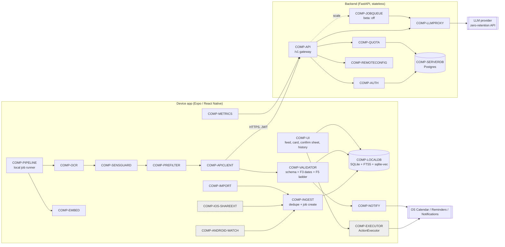

# 2 — Systems architecture (v1 / beta)

Author: Systems architect, Round 2. Design only. Scope: FEATURES.md F1–F8, nothing else.
Core principle: **model proposes, deterministic code validates and executes, user confirms.**

Dependencies on parallel agents (stated as assumptions; Chair reconciles):
- **A-PLAT** (platform researcher): Android allows background detection of new screenshots via a MediaStore content trigger; iOS does not allow true background watching of the photo library, so iOS detection = share extension + scan-on-open (+ optional Shortcuts automation).
- **A-AI** (AI pipeline): extraction is one tool-calling LLM request per screenshot, input = OCR text + layout blocks, image only when needed; output = JSON schema below. Prompt and model choice are theirs.
- **A-ACT** (action engine): destinations per platform (iOS EventKit events/reminders; Android CalendarContract events, reminders as calendar events with alarms or local notifications). I define only the interface `ActionExecutor`.
- **A-PRIV** (privacy): sensitive-content rules and the disclosure text. I define where the guard sits and what bytes cross the wire.

---

## 1. Platform and framework decision

**Decision: React Native with Expo (TypeScript, dev-client builds, EAS Build), one codebase, Android and iOS. Two small native modules written by hand.**

| Option | Fit to builder | UI quality | Auto-detect (F1) | Verdict |
|---|---|---|---|---|
| PWA (React) | Best | Web-feeling | None on either OS; no calendar write; no background OCR | Rejected: fails F1(b), F4 needs .ics downloads, F5 notifications unreliable on iOS |
| **Expo / React Native** | Strong (TS + React) | Near-native: renders real native views; FlashList handles 10k rows | Android: yes via native module; iOS: share ext + on-open scan | **Chosen** |
| Flutter | New language (Dart) | Very good, but custom-drawn, not native widgets | Same OS limits, same native work | No advantage over RN for this builder |
| Native Swift + Kotlin | No experience, two codebases | Best | Same OS limits | Best polish, worst schedule risk for mid-January |

Honest trade-offs:
- RN does not remove native work. Capture is native on both OSes. Budget: **COMP-ANDROID-WATCH** (~200 lines Kotlin, Expo Modules API: `JobScheduler` with `addTriggerContentUri` on `MediaStore.Images`, filtered to the Screenshots bucket) and **COMP-IOS-SHAREEXT** (iOS share extension via a config plugin such as `expo-share-intent`, or a ~150-line Swift extension that writes the file into the App Group container). Claude Code can write both; the risk is debugging, not authoring.
- Off-the-shelf modules cover the rest: `@react-native-ml-kit/text-recognition` (on-device OCR, both OSes), `expo-calendar` (events on both, iOS reminders), `expo-notifications` (local notifications), `expo-sqlite` (SQLite with FTS5; `sqlite-vec` loaded as extension), `onnxruntime-react-native` (on-device embeddings), `@shopify/flash-list`.
- **Ship Android first for the magic moment** (true auto-detect works there); iOS beta ships with share extension + scan-on-open + "new screenshots found" in-app card. The code is shared; only capture differs. If A-PLAT finds a reliable iOS trigger, it plugs into the same `CaptureSource` interface.
- No rewrite path to 1M: RN is used at that scale; the expensive parts (native capture, OCR, executors) are already native modules.

## 2. On-device vs server split

Rule: anything that is deterministic or good-enough locally stays local. The server exists only to hold the LLM key, meter cost, and (later) queue work.

| Step | Where | Why |
|---|---|---|
| Detect / import, dedupe (perceptual + SHA-256 hash) | Device | Needs the photo library; no reason to leave |
| OCR + text blocks with boxes | Device (ML Kit / Vision) | Good enough for screenshots (clean digital text); free; private |
| Sensitive-content guard | Device | F7(b): must run **before** anything is sent |
| Pre-filter "obviously nothing to do" (no digits/dates/time words, < N chars) | Device | Saves LLM calls and bytes; conservative (only drops clear non-actions) |
| Classify + extract fields + confidence | **Server-proxied LLM** | Only part not good enough on ordinary phones in Jan 2027 |
| Date/time resolution (F3), validation, deadline ladder (F5) | Device (pure TS) | Deterministic; testable; uses device timezone and capture time |
| Embeddings for search (F6) | Device (small ONNX text model, ~25–35 MB quantized, 384-dim) | Avoids sending text of non-actionable screenshots just for search |
| Execute action, undo, log | Device | OS APIs; nothing to send |
| Metrics (F8) | Device aggregates, server receives counts | Counts only |

**Bytes sent per screenshot (justified):** OCR text (typically 0.5–4 KB) + block geometry (optional, ~2 KB) + capture timestamp + tz offset + locale. The downscaled image (≤1024 px JPEG, ~100 KB) is sent **only** if A-AI shows text-only extraction fails on a class of screenshots (e.g., flyers where layout carries meaning) and only when the user's setting allows images. Nothing is sent for screenshots flagged sensitive or pre-filtered out. The server does not persist content (§6).

## 3. Component diagram



Each component is a separately testable unit with a file-level contract; the builder can resume from any one. Order of build: COMP-LOCALDB → COMP-IMPORT/INGEST → COMP-OCR → COMP-VALIDATOR (pure TS, test table first) → COMP-API/PROXY → COMP-PIPELINE → COMP-UI card/confirm → COMP-EXECUTOR → COMP-NOTIFY → COMP-ANDROID-WATCH → COMP-IOS-SHAREEXT → COMP-EMBED/search → COMP-METRICS.

## 4. Local data model (COMP-LOCALDB)

SQLite (WAL mode). All IDs are ULIDs (sortable, globally unique, sync-safe). Every mutable row has `updated_at` and `deleted_at` (tombstone) so sync can be added later without migrating keys. Images are **not copied**: we store the OS asset reference plus hash; imported/shared files that are not in the library are copied to app storage.

```sql
CREATE TABLE screenshot (
  id TEXT PRIMARY KEY,               -- ULID
  source TEXT NOT NULL,              -- 'auto'|'share'|'import'|'scan'
  asset_ref TEXT,                    -- MediaStore URI / PHAsset localIdentifier
  file_path TEXT,                    -- app-owned copy if no asset_ref
  sha256 TEXT NOT NULL, phash INTEGER,
  captured_at INTEGER NOT NULL,      -- epoch ms, from EXIF/asset; anchor for F3
  tz TEXT NOT NULL,                  -- IANA tz at capture
  width INTEGER, height INTEGER,
  state TEXT NOT NULL,               -- pipeline state, see §9
  klass TEXT,                        -- 'event'|'deadline'|'none'|NULL
  sensitive INTEGER NOT NULL DEFAULT 0,
  created_at INTEGER, updated_at INTEGER, deleted_at INTEGER
);
CREATE UNIQUE INDEX ux_ss_sha ON screenshot(sha256);           -- F1(d) never twice
CREATE INDEX ix_ss_feed ON screenshot(deleted_at, captured_at DESC); -- feed paging
CREATE INDEX ix_ss_state ON screenshot(state) WHERE state NOT IN ('done','skipped');

CREATE TABLE ocr (screenshot_id TEXT PRIMARY KEY REFERENCES screenshot(id),
  text TEXT NOT NULL, blocks_json TEXT, engine TEXT, ms INTEGER);
CREATE VIRTUAL TABLE ocr_fts USING fts5(text, content='ocr', content_rowid='rowid',
  tokenize='unicode61 remove_diacritics 2');

CREATE TABLE extraction (            -- raw model output, immutable, one per attempt
  id TEXT PRIMARY KEY, screenshot_id TEXT NOT NULL REFERENCES screenshot(id),
  schema_version INTEGER NOT NULL, model TEXT, prompt_version TEXT,
  klass TEXT, raw_json TEXT NOT NULL, created_at INTEGER);
CREATE INDEX ix_ext_ss ON extraction(screenshot_id, created_at DESC);

CREATE TABLE proposed_action (       -- validated proposal shown on a card (max 3/screenshot)
  id TEXT PRIMARY KEY, screenshot_id TEXT NOT NULL, extraction_id TEXT NOT NULL,
  kind TEXT NOT NULL,                -- 'calendar_event'|'reminder'
  fields_json TEXT NOT NULL,         -- {title:{value,conf,flag,assumption,src_span}, start:{...}, ...}
  ladder_json TEXT,                  -- F5 offsets, code-computed
  status TEXT NOT NULL,              -- 'ready'|'needs_review'|'confirmed'|'dismissed'|'failed'
  created_at INTEGER, updated_at INTEGER, deleted_at INTEGER);
CREATE INDEX ix_pa_status ON proposed_action(status, created_at DESC);
CREATE INDEX ix_pa_ss ON proposed_action(screenshot_id);

CREATE TABLE executed_action (       -- F7(c) action log; undo needs os_item_id
  id TEXT PRIMARY KEY, proposed_action_id TEXT NOT NULL,
  destination TEXT NOT NULL,         -- 'ios_eventkit_event'|'android_calendar'|...
  os_item_id TEXT NOT NULL, calendar_id TEXT,
  written_json TEXT NOT NULL,        -- exactly what was written (F4b check)
  executed_at INTEGER NOT NULL, undone_at INTEGER, undo_error TEXT);
CREATE INDEX ix_ea_time ON executed_action(executed_at DESC);

CREATE TABLE correction (            -- user edits, per field; feeds F8 edit rate + post-beta teach
  id TEXT PRIMARY KEY, proposed_action_id TEXT NOT NULL,
  field TEXT NOT NULL, before_json TEXT, after_json TEXT, was_flagged INTEGER,
  created_at INTEGER);
CREATE INDEX ix_corr_field ON correction(field);

CREATE VIRTUAL TABLE embedding USING vec0(
  screenshot_id TEXT PRIMARY KEY, v float[384]);   -- sqlite-vec; model id in kv table

CREATE TABLE job (                   -- local durable work queue (COMP-PIPELINE)
  id TEXT PRIMARY KEY, screenshot_id TEXT NOT NULL, step TEXT NOT NULL,
  attempts INTEGER DEFAULT 0, next_run_at INTEGER, last_error TEXT,
  server_job_id TEXT);              -- set when server answers 202
CREATE INDEX ix_job_due ON job(next_run_at);

CREATE TABLE metric_counter (day TEXT, name TEXT, dim TEXT, n INTEGER,
  PRIMARY KEY(day, name, dim));     -- F8: counts only
CREATE TABLE kv (k TEXT PRIMARY KEY, v TEXT);  -- schema_version, embed_model, device_id
```

Scale notes (10,000+ screenshots on one phone): rows are small (~2–6 KB with OCR) → ~50 MB DB at 10k; FTS5 query < 20 ms; sqlite-vec brute-force KNN over 10k × 384 floats (15 MB) ≈ 10–30 ms on a mid-range phone; at 50k, still < 150 ms, and sqlite-vec's quantized/binary vectors are the drop-in upgrade. Feed uses keyset pagination on `ix_ss_feed` + FlashList + thumbnails from the OS (no thumbnail cache of our own). Search = hybrid: FTS5 BM25 top-50 ∪ vector top-50, merged by reciprocal rank fusion, in TS. Proposed p95 budget for DESIGN.md: **≤ 300 ms on a 2022 mid-range Android at 10k items.**

Migrations: numbered SQL files, `kv.schema_version`, forward-only, run at app start in a transaction.

## 5. Sync and backup

**v1: no sync, no server backup.** The library is local-first. Justification: privacy (F7) and cost; beta testers do not need it.
- Backup in v1: the DB file is included in OS backup (iOS iCloud device backup; Android Auto Backup, under its 25 MB cap for the DB plus `kv`; embeddings and FTS are excluded and rebuilt). Images are already in the user's photo library; we hold references.
- Restore: on a new phone, asset references may not resolve; rows are re-linked by `sha256` during a scan-on-open, and unresolved rows show "image not on this device."
- **Added later without rewrite:** ULIDs + `updated_at` + tombstones already make every row a mergeable record. v2 adds an encrypted change-log sync (client-side encryption with a key held in OS keychain/passkey; server stores opaque blobs keyed by `user_id, table, row_id, updated_at`, last-writer-wins per field for `proposed_action.fields_json`, append-only for `executed_action` and `correction`). No table or key changes; only a `sync_cursor` in `kv` and a new `/v1/sync` endpoint.

## 6. Server data model (COMP-SERVERDB)

Postgres (managed: Neon or Supabase free tier for beta). **No screenshot content, OCR text, or extracted fields are stored server-side.** Request bodies are not logged.

```sql
users(id uuid pk, created_at, invite_code text, status text,       -- 'active'|'deleted'
      tier text default 'beta')
devices(id uuid pk, user_id fk, platform text, app_version text,
        attest_ok bool, refresh_hash text, created_at, last_seen_at)
usage_daily(user_id, day date, extractions int, input_tokens int,
            output_tokens int, image_calls int, primary key(user_id, day))
request_log(id, user_id, ts, endpoint, status, latency_ms, model,
            prompt_version, error_code)        -- metadata only, 30-day TTL
metric_counts(user_id, day, name, dim, n)      -- F8 uploads, counts only
deletion_receipts(user_id, requested_at, completed_at)
jobs(id uuid pk, user_id, status, created_at, result_enc bytea, expires_at)  -- only when queue on; result deleted on fetch or after 24 h
```
Indexes: `devices(user_id)`, `request_log(ts)` (for TTL purge), `usage_daily` PK. At 1M users these tables stay small (metadata only); `request_log` partitioned by day.

F7(d) delete-my-data: `DELETE /v1/me` removes all rows for the user (cascade) and writes a receipt; a test asserts zero rows remain. Local delete is `DELETE` + `VACUUM` of local rows and app-owned copies.

## 7. Backend services

Single FastAPI service, stateless, containerized (Fly.io or Cloud Run, scale-to-zero for beta, ~$0–20/month + LLM spend).
- **COMP-AUTH.** Beta: invite code + anonymous device registration. Device creates a keypair (Secure Enclave/Keystore); server issues short-lived JWT access token (15 min) and rotating refresh token. Attestation (App Attest / Play Integrity) checked at registration, recorded in `devices.attest_ok`, enforced post-beta. Account linking (Sign in with Apple/Google) added later by attaching a provider identity to the existing `users.id`, so no data migration.
- **COMP-LLMPROXY.** The only holder of the LLM API key (in the host's secret store, never in the app binary). Builds the provider request from a server-side prompt template (`prompt_version`), forces tool-calling with the extraction JSON schema, enforces max input size (16 KB text, 1 image), timeout 20 s, one retry. Uses a provider zero-data-retention setting where available. Provider-agnostic adapter so A-AI can switch models via COMP-REMOTECONFIG.
- **COMP-QUOTA.** Per-user daily caps (e.g., 200 extractions/day beta) and global spend kill switch; Postgres counters in beta, Redis at scale.
- **COMP-JOBQUEUE.** Off in beta: extraction runs inline in the request (p50 3–6 s). At scale, flip a config flag: API returns `202 {job_id}`, workers (same codebase, `arq`/Redis or Cloud Tasks) call the proxy, client polls or receives a silent push. The client already handles both (§8), so this is configuration, not a rewrite. Bulk backlog import (post-beta) always uses the queue with batch-API pricing.
- **COMP-REMOTECONFIG.** `GET /v1/config`: min app version, feature flags (image upload allowed, prefilter thresholds), model + prompt version, quota numbers.

## 8. API design and versioning

Base `https://api.<domain>/v1`. JSON, HTTPS only, `Authorization: Bearer <jwt>`, `Idempotency-Key` header = screenshot `sha256` + attempt (repeat calls return the cached result for 10 min, which also enforces F1(d) server-side).

| Method | Path | Purpose |
|---|---|---|
| POST | /v1/auth/register | invite code + device public key + attestation → tokens |
| POST | /v1/auth/refresh | rotate tokens |
| GET | /v1/config | remote config |
| POST | /v1/extract | `{schema_version, ocr_text, blocks?, captured_at, tz, locale, image_b64?}` → `200 {extraction}` or `202 {job_id, retry_after}` |
| GET | /v1/jobs/{id} | `200 {extraction}` / `202` / `410` |
| POST | /v1/metrics | daily counter batch |
| DELETE | /v1/me | delete all server data |

Extraction contract (owned jointly with A-AI; schema here is the boundary, not the prompt):
```json
{ "schema_version": 1, "class": "event|deadline|none",
  "actions": [ { "kind": "calendar_event|reminder",
     "fields": { "title": {"value": "Pizza night", "conf": 0.93, "src": "Pizza Night!"},
                 "start_text": {"value": "Fri 7pm", "conf": 0.88, "src": "Fri 7pm"},
                 "location": {"value": null, "conf": 0, "src": null} } } ] }
```
The model returns **date text, not timestamps**; COMP-VALIDATOR resolves it (F3). Every field must quote a `src` substring present in the OCR text, or it is flagged; this is the deterministic check for F2(c) "never invents."

Versioning: URL major (`/v1`); additive fields only within a major; `schema_version` in request and response so the server can serve older clients; `min_app_version` in config forces upgrade for breaking changes; `/v2` runs side by side for one release cycle.

## 9. Pipeline, offline behavior, and the flow to "action ready"

Screenshot `state` machine (persisted; COMP-PIPELINE resumes after kill/reboot):
`new → ocr_done → (sensitive → skipped_local) | (prefiltered → done_none) → extract_pending → extracted → validated → ready | needs_review | done_none` ; errors → `retry_wait` (exponential backoff 30 s → 6 h, max 8) → `failed` (visible, retry button).

**Offline:** capture, OCR, sensitive guard, prefilter, FTS indexing, embeddings, feed, search, confirm, execute, undo, and history all work offline. Only `extract_pending` waits for network; the feed shows "Waiting for connection to read this." Android uses WorkManager with a network constraint; iOS retries on foreground and `BGProcessingTask` (best effort). Confirmed actions never need the network.

```mermaid
sequenceDiagram
  participant OS as OS (MediaStore / Share)
  participant W as COMP-ANDROID-WATCH / IOS-SHAREEXT
  participant P as COMP-PIPELINE
  participant DB as COMP-LOCALDB
  participant S as COMP-API → LLMPROXY
  participant V as COMP-VALIDATOR
  participant N as COMP-NOTIFY
  OS->>W: new screenshot URI / shared file
  W->>P: enqueue(asset_ref)
  P->>DB: hash; INSERT screenshot (unique sha256) — duplicate? stop
  P->>P: OCR on-device (≈0.3–1 s)
  P->>P: sensitive guard → if hit: state=skipped_local, stop
  P->>P: prefilter → if clearly none: state=done_none, stop (silent, F2d)
  P->>S: POST /v1/extract (OCR text, tz, captured_at)
  S-->>P: 200 extraction (or 202 → poll / push)
  P->>DB: INSERT extraction (raw)
  P->>V: validate schema, src-quote check, resolve dates (F3), ladder (F5)
  V->>DB: INSERT proposed_action(s) status=ready|needs_review
  alt class != none
    P->>N: local notification "Event ready: Pizza night, Fri 7 pm (1 field to check)"
  else none
    P->>DB: state=done_none (no notification)
  end
  P->>P: embed OCR text → embedding (deferred, low priority)
```
Target time-to-card: p50 ≤ 6 s, p95 ≤ 15 s on network (F8 measures it). Confirm path (UI): card → confirm sheet (flagged fields must be touched) → `ActionExecutor.execute(action) → {os_item_id}` → `executed_action` row → toast with Undo (`ActionExecutor.undo(os_item_id)`).

`ActionExecutor` interface (A-ACT implements): `requestPermission(kind)`, `execute(kind, fields, ladder) → {destination, os_item_id, written}`, `undo(destination, os_item_id)`, `verify(os_item_id) → bool`.

## 10. Scaling to 1M users without a rewrite

- Per-user data lives on the device; server load scales with **extractions/sec**, not library size. 1M users × ~3 screenshots/day ≈ 35 req/s average, ~150 peak: a handful of stateless containers. The dominant cost is LLM tokens; levers are the prefilter, smaller models, prompt caching, and batch pricing for backlog.
- Switches, not rewrites: COMP-JOBQUEUE flag; Redis for quotas/idempotency; Postgres read replica not needed (metadata only); request_log partitioning; CDN irrelevant (no media).
- Heavy users (10k+): all indexes are local and covered above; backlog import is rate-limited client-side (e.g., 50/hour, batched via queue).

## 11. Key decisions and trade-offs

| ID | Decision | Trade-off accepted |
|---|---|---|
| D1 | Expo/RN, two hand-written native capture modules | Some native debugging; slightly less iOS polish than SwiftUI |
| D2 | Android-first auto-detect; iOS share + scan-on-open | iOS magic moment needs one share tap |
| D3 | On-device OCR, text-only to LLM by default | Some layout-dependent flyers may extract worse (A-AI to measure) |
| D4 | Model returns date text; code resolves | Slightly more client code; fully testable F3 |
| D5 | On-device embeddings | +30 MB app size; first-run model download (cut to FTS-only if build slips) |
| D6 | No sync in v1; sync-ready keys | Lost phone without OS backup loses the library |
| D7 | Inline extraction in beta; queue-shaped API | None at beta; queue switch later |
| D8 | Server stores no content | Harder to debug extraction failures: rely on opt-in "send this example" reports |
